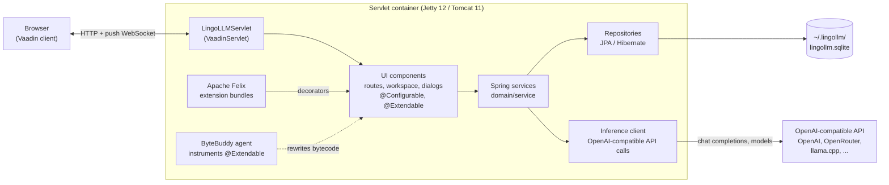
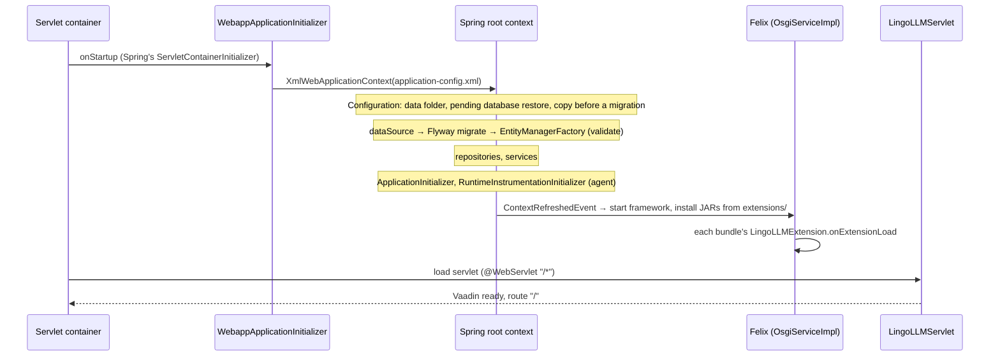
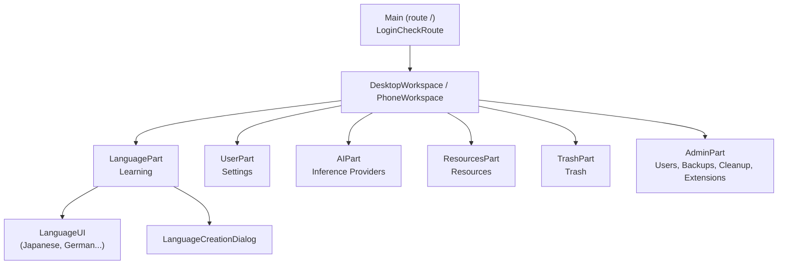
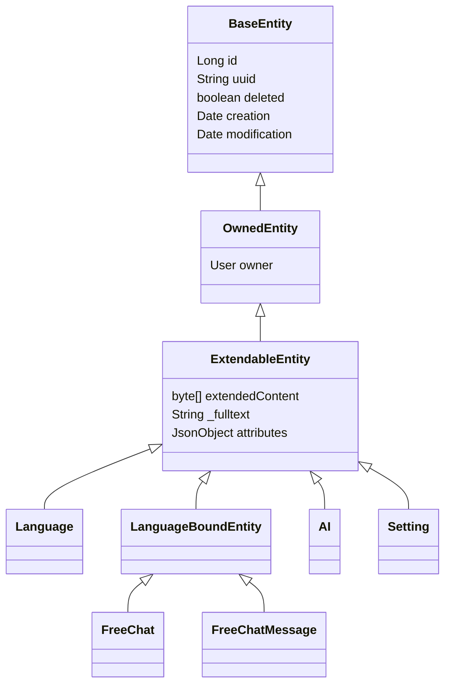
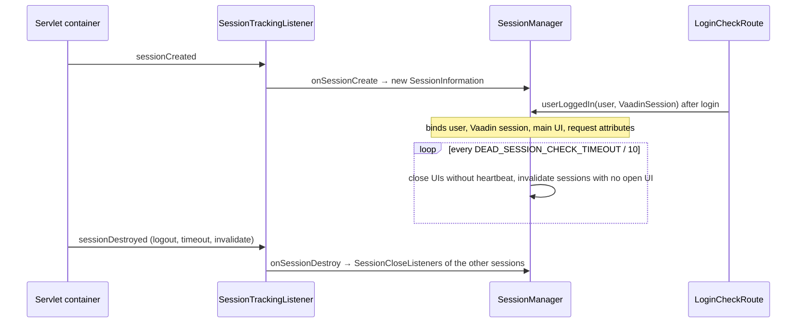
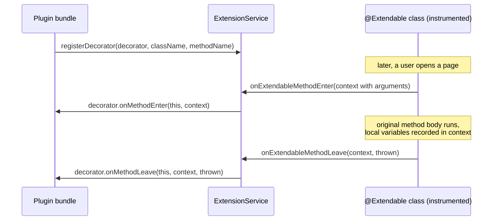
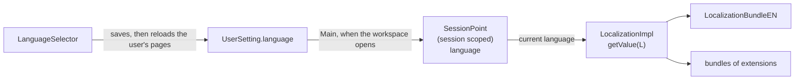

# Architecture

LingoLLM is one Java web application running in one JVM. There is no separate frontend project, no REST API and no
external database: the browser shows Vaadin components that live on the server, the components call Spring services,
and the services store everything in a single SQLite file. Calls to an OpenAI-compatible HTTP API
run on background threads and push their results to the browser. Extensions are OSGi bundles loaded into
the same JVM; they change the UI by hooking into methods of instrumented classes.



## Design in brief

- **Server-side UI.** Vaadin Flow keeps the component tree on the server; the browser renders it and sends events
  back. UI code is ordinary Java that calls services directly - there is no API layer to keep in sync.
- **Spring without Spring Boot.** The application context is built from XML files; services and repositories are
  explicit beans. Vaadin components are created with `new` and get their dependencies through AspectJ-woven
  `@Configurable`.
- **One file of data.** SQLite in WAL mode, schema managed by Flyway, mapped by Hibernate. Backing up an installation
  means copying one folder.
- **Multi-user, single process.** Every entity belongs to a user; services filter by the user of the current HTTP
  session. All users share one JVM and one database.
- **Language profiles.** A user has several language profiles; everything learned belongs to one, and the profile of
  the session is a session-scoped bean ([Domain model](domain-model.md#the-language-of-the-session)).
- **Runtime extensions.** OSGi bundles can be loaded and unloaded without a restart. The UI classes they extend are
  instrumented at startup so that any of their methods can be decorated.

## Runtime and deployment

The build produces one WAR. It is deployed in a different container depending on how LingoLLM is run, but the code
is the same everywhere:

| Mode | Container | Data folder | Notes |
|---|---|---|---|
| Docker | Jetty 12 (`jetty:12-jdk25` image), WAR as `ROOT.war` | `/var/lingollm/.lingollm` (volume `./data`) | Built by the [Dockerfile](packaging.md). Listens on 8080. |
| Desktop app | `jetty-home` 12 started in-process by `DesktopLauncher` | `~/.lingollm` | Bundled jlink runtime, listens on `127.0.0.1:8765`, tray icon. |
| Development | Tomcat 11 / Jetty 12 from the IDE | `<user.home>/.lingollm` | See [Running locally](building.md#running-locally). |

`DesktopLauncher` (`lingollm/src/desktop/java`) depends on the JDK only: it prepares a Jetty base in
`~/.lingollm/desktop/`, starts Jetty's `start.jar` by reflection in the same JVM, opens the browser and shows the tray
icon. It is compiled separately and never ends up in the WAR. See [Packaging & releases](packaging.md).

## Startup



1. The container finds Spring's `SpringServletContainerInitializer`, which calls
   `ui/main/WebappApplicationInitializer`. It creates an `XmlWebApplicationContext` from
   `META-INF/spring/application-config.xml` and registers the `ContextLoaderListener`, the `RequestContextListener`
   (makes request and session scoped beans work) and the `SessionTrackingListener` (feeds HTTP sessions to the
   `SessionManager`, see [Sessions](#sessions)).
2. `application-config.xml` loads `config/configuration.properties`, the build info and `git.properties`, enables
   annotation config, `@Configurable` (`context:spring-configured`), `@Async`/`@Scheduled`
   (`task:annotation-driven`) and AspectJ auto-proxies, scans `com.github.enerccio` for components, and imports three
   files:

   | File | Defines |
   |---|---|
   | `container-config.xml` | `localization` (with its language bundles), `configuration`, `applicationPoint`, `sessionManager`, the session-scoped `user`, `language` and `sessionPoint`, `ApplicationInitializer` |
   | `datasources-config.xml` | SQLite data source (commons-dbcp), Flyway, the `EntityManagerFactory`, the `common` transaction manager |
   | `services-config.xml` | Every repository and service, OSGi, extensions, database backups, cleanup, the instrumentation initializer |

3. `Configuration` resolves the data folder (`<user.home>/.lingollm`) and creates its subfolders. When the data
   source asks for the database URL (`configuration.resolveDb(...)`), a staged database restore
   (`lingollm.sqlite.restore`) is swapped in first - a restore can't replace a database that is open. Then a copy of
   an existing database that is behind the bundled migrations is saved in `db-backups` (`pre-migration-*`, see
   [Startup](database.md#startup-migrate-then-validate)).
4. Flyway migrates the schema (`classpath:migration`), then Hibernate builds the `EntityManagerFactory` with
   `hbm2ddl.auto=validate`. A mismatch between entities and schema stops the startup here.
5. `RuntimeInstrumentationInitializer` installs the ByteBuddy agent and registers a transformer for all classes
   annotated `@Extendable` (see [Extensions](#extensions)). Classes already loaded are retransformed.
6. When the root context is refreshed, `OsgiServiceImpl` starts Apache Felix with `~/.lingollm/extensions` as its
   storage, installs and starts every JAR in that folder and calls `onExtensionLoad` on each registered
   `LingoLLMExtension`. A JAR that fails is logged and skipped. When the root context closes, the extensions are
   unloaded and the framework is stopped.
7. `LingoLLMServlet` (`@WebServlet("/*")`, a `VaadinServlet`) serves the UI. `AppShellConfig` configures the page:
   push enabled, dark Lumo theme, `shared-styles.css`.

## Layers and packages

All application code is in `com.github.enerccio.lingollm` (`lingollm/src/main/java/...`):

| Package | Layer | Contents |
|---|---|---|
| `ui.main` | UI | Servlet, app shell, the route `Main` (`/`), login handling (`LoginCheckRoute`). |
| `ui.workspace`, `ui.workspace.parts` | UI | The workspace after login and its tabs: learning, settings, inference providers, resources, trash, admin. |
| `ui.dialogs`, `ui.lang` | UI | Dialogs (language profile, provider, user...); the learnable languages and their UIs. |
| `ui.components`, `ui.widgets` | UI | Reusable components and small widgets. |
| `domain.components` | Services | Plain data and helpers shared by services and the UI (`AILimit`, `AILimits`, `LimitStatus`, `CronSchedule`). |
| `domain.service` (+ `impl`) | Services | Business logic, one service per entity plus inference, database backups, cleanup, extensions. |
| `domain.service.impl.inference` | Services | The OpenAI-compatible client. |
| `domain.repository` (+ `impl`) | Data | JPA repositories. |
| `domain.model` (+ `impl`) | Data | Entities and their base classes. |
| `domain.security` | Data / services | `User`, its repository and service, saved logins. |
| `domain.traits`, `domain.collections`, `domain.listener` | Shared | Annotations (`@CommonTx`, `@Extendable`, `@PublicAPI`, `@CleanupReference`...), enums, the entity listener for extended attributes. |
| `extensions`, `instruct` | Extensions | The `LingoLLMExtension` interface, the bytecode instrumentation. |
| `bound` | Startup, sessions | Application initializer and migrations hook, the `SessionManager` and its session bookkeeping. |
| `loc` | Shared | Localization: the `L` keys and the English texts. |
| `concurrent`, `utils` | Shared | Helpers. |

The UI depends on services, services on repositories, repositories on the entities - not the other way round. UI
classes may read entities directly (they are detached JPA objects), but all changes go through services.
[Project structure](project-structure.md) lists the files in detail.

## Spring wiring

**Services and repositories** are declared in `services-config.xml`, one repository bean per entity injected into its
service:

```xml
<bean id="languageRepository" class="...repository.impl.JpaLanguageRepository">
    <property name="entityManager" ref="em"/>
</bean>

<bean class="...service.impl.LanguageServiceImpl">
    <property name="repository" ref="languageRepository" />
</bean>
```

Inside the services, other beans are `@Autowired` by interface. A new service needs a bean definition here - the
component scan doesn't pick up the service implementations.

**UI classes** are not Spring beans. They are created with `new` (`new LanguageCreationDialog()`) and annotated
`@Configurable` (most with `preConstruction = true`, so fields are injected before the constructor body runs). The
AspectJ compiler weaves `AnnotationBeanConfigurerAspect` into them, which autowires their fields from the root
context. This only works for classes compiled by `ajc` - see [AspectJ weaving](building.md#aspectj-weaving).

**Transactions** use the `common` transaction manager (`JpaTransactionManager`) and are applied by Spring's CGLIB
proxies around the service beans (`tx:annotation-driven`, `proxy-target-class="true"`) - so only calls that come
through a bean reference are transactional, not calls of a service to its own methods (see
[Services](services.md#transactions)). Service methods are annotated with the meta-annotations from `domain.traits`:

| Annotation | Meaning |
|---|---|
| `@CommonTx` | `@Transactional("common")` - read/write transaction. |
| `@CommonTxReadOnly` | Read-only transaction. |
| `@NoTx` | Runs outside a transaction (`NOT_SUPPORTED`), for methods that only start background work. |

**The current user** is the session-scoped bean `user` (`User` behind a scoped proxy). After login, `Main` copies the
logged-in user's id, login and name into it; services inject `User` and use it to set and check ownership
(`OwnedService.findAllForUser()`, `findForUser(uuid)`). **The current language profile** is the session-scoped bean `language` in the same way, filled by `LanguagePart`.
Code running outside a request (background threads) needs the
request attributes copied over - see [Threads and push](#threads-and-push).

**Configuration** comes from `src/main/webapp/config/configuration.properties`:

| Key | Default | |
|---|---|---|
| `allowPersistentLogin` | `true` | Whether *Save login* is offered. |
| `persistentLoginTTL` | `2592000` | Lifetime of saved logins in seconds (30 days). |
| `trustedProxies` | empty | Reverse proxies (addresses or CIDR ranges, comma separated) whose `X-Forwarded-For` header is believed when finding the client address for [login throttling](services.md#login-throttling). Empty: the header is ignored. Can also be given as `-DtrustedProxies=...`. |

## User interface



- `Main` shows the login (or the *create administrator* dialog on an empty installation), restores a saved login
  from cookies, and after login replaces its content with the `DesktopWorkspace` or the `PhoneWorkspace` (both
  implement `Workspace`).
- `DesktopWorkspace` holds the left-hand tabs. Each tab is a `WorkspaceComponent` (`create`, `refresh`, `onTabSwitched`,
  `onTabClosed`).
- `LanguagePart` is the first tab: the selector of the language profiles above the `LanguageUI` the template of the
  selected profile creates (`Languages.create(workspace)`). With no profile it opens `LanguageCreationDialog` and does
  not let it be closed (the initial setup).

Most of these classes are `@Extendable`, which is what makes them extension points. See
[User interface](ui.md) for details.

## Data



All data entities extend `ExtendableEntity`. `User` extends `BaseEntity` directly and `Resource` and `Usage` are `OwnedEntity`s.

- Every entity has a numeric `id` (database key) and a `uuid` (stable identity used in URLs, backups and exports).
- Deleting is **soft** by default (`deleted = true`); the admin *Cleanup* page purges deleted rows that nothing
  references any more, following the `@CleanupReference` annotations.
- `OwnedEntity.owner` ties data to a user. `ExtendableEntity.attributes` is a JSON object, stored serialized in
  `extendedContent` by `ExtendableEntityListener`, where extensions keep their own data (and where `@ExtendedAttribute`
  fields of the entity are stored) - so that data travels with backups and exports without schema changes. The same
  listener fills `_fulltext` with the text of the `@Fulltextable` fields, for searching.
- The messages of a free chat form a tree (`FreeChatMessage.parent`); its attachments are loose links by resource uuid.

The database is SQLite in WAL mode (`busy_timeout=10000`), through a commons-dbcp pool and a
`TransactionAwareDataSourceProxy`. Flyway migrations in `src/main/resources/migration/` create and upgrade the schema,
and every entity is listed in `src/main/webapp/config/persistence.xml` (`exclude-unlisted-classes`).
`SaneSQLiteDialect` adapts Hibernate's community SQLite dialect. See [Domain model](domain-model.md) and
[Database & migrations](database.md).

## Threads and push

Vaadin UI state may only be changed while holding the session lock. Code on other threads - backups,
long running requests - updates the UI with `ui.access(...)`, and the change reaches the browser through server push
(`@Push` on `AppShellConfig`, WebSocket with long-polling fallback). Two helpers make this safe:

- `UIPushGuard.push(ui)` pushes explicitly but never re-entrantly from the same thread.

Background threads have no HTTP request, so session-scoped beans (the current `user` and `language`) would not
resolve. Code that starts background work captures the request attributes in a `ThreadCopyRequestAttributes` and wraps
the work in `ThreadCopyRequestAttributes.InRequestScope`, which makes the session of the user who started it current
on the worker thread.

## Sessions

`bound/SessionManager` (bean `sessionManager`, defined in `container-config.xml`) knows every HTTP session of the
application and which user is logged into it.



- **Tracking.** `SessionTrackingListener` is an `HttpSessionListener` registered in `WebappApplicationInitializer`;
  it looks the bean up in the root context and calls `onSessionCreate` / `onSessionDestroy`. Each session gets a
  `SessionInformation`. After a successful login `Main` calls `userLoggedIn(user, VaadinSession)`, which
  fills it in once: the Vaadin session, the user, the current UI as the *main UI* and a `ThreadCopyRequestAttributes`
  copy of the request. Note that login calls `VaadinService.reinitializeSession` - the old session is destroyed and a
  new one created, so the bound session is the new one.
- **Running code in other sessions.** `runForUsers(test, runnable, uiBound)` runs a `RunInSession` for every session
  whose user matches the predicate, with that session's request attributes in scope (so the session-scoped `user`
  resolves to *that* user). With `uiBound` the runnable is queued with `VaadinSession.access` on a live UI of the
  session (the main UI, or any other open one if it was closed) - it runs asynchronously, once the session lock is
  free, and changes are pushed when the lock is released. The sessions are processed on a separate thread
  (`ThreadUtils.executeInThread`), so the caller's Vaadin and request thread locals don't leak into them; the call
  waits for the dispatch, not for the queued `access` tasks. The `skipCurrent` overload leaves out the caller's own
  Vaadin session. `UserServiceImpl.changePassword` / `clearPassword` use it to invalidate the other sessions of the
  user whose password changed - a user changing their own password stays logged in in the current session.
- **Open UIs.** After login `Main` registers their UI in `ApplicationPoint` (bean `applicationPoint`)
  with the workspace and a copy of the user. `SessionInformation.getUI(workspaceClass, applicationPoint)`
  / `getWorkspace(...)` find the session's UI showing a given workspace type.
- **Dead UI detection.** `SessionManager` is also a daemon thread (*Inactive session watcher*), started by
  `afterPropertiesSet` and stopped on context shutdown. Every `DEAD_SESSION_CHECK_TIMEOUT / 10` seconds (see
  `Constants`) it `tryLock`s each logged-in session - a locked session is in use and skipped - and closes UIs whose
  last heartbeat is older than the timeout. Threads queued on the session lock count as activity. The timeout is
  never shorter than three Vaadin heartbeat intervals (5 minutes by default), otherwise an open but idle tab would be
  closed between two heartbeats. When every UI of the session is closing, the HTTP session is invalidated.
- **Close notifications.** `addSessionCloseListener` registers a `SessionCloseListener` on the current session. When
  another session is destroyed, every listener of every remaining session is called inside its own session's
  `access` and request scope with the `SessionInformation` of the closed session.
- `getActiveUsers()`, `getOpenedSessions(user)`, `getSessionInformation(id)` and `getActiveSessionIds()` expose the
  registry, e.g. for admin views.

## Extensions



- **Loading.** Extensions are OSGi bundles run by an embedded Apache Felix framework (`OsgiServiceImpl`). Boot
  delegation is open for all packages (`org.osgi.framework.bootdelegation=*`, parent = the framework's class loader,
  which is the web application's), so bundles see the application's classes and libraries directly without importing
  them. A bundle registers a `LingoLLMExtension` service;
  LingoLLM calls `onExtensionLoad` / `onExtensionUnload` and passes the `ExtensionService`. Before an extension is
  started, `ExtensionService.verifyExtension` checks the classes, methods, arguments, locals and fields its decorators
  use against the running application (the result is kept in `name.valid` / `name.invalid` next to the JAR); an
  extension that doesn't fit is not started.
- **Instrumentation.** At startup a ByteBuddy agent rewrites every non-static, non-constructor method of each class
  annotated `@Extendable`: `ExtendableMethodVisitor` adds a call to `ExtensionService.onExtendableMethodEnter` at the
  start, records each local variable as it is stored, and calls `onExtendableMethodLeave` on every return and throw (at the return of a value the original value is registered first and the one the decorators leave is returned).
  This happens on every call, with or without decorators, so `@Extendable` belongs on UI classes, not on hot code.
- **Decorators.** `ExtensionService.registerDecorator(decorator, className, methodName)` attaches code before and
  after a method. Through the `ExtendableMethodContext` it can read the method's arguments, read local variables by
  name (for example the menu the method just built, to add an item to it) and access fields and methods reflectively.
  On enter it can replace arguments, on leave it can replace the return value (chained through the decorators); it can't skip the method.
- **Data.** Extensions keep their data in the `attributes` of existing entities, so no schema changes are needed and
  the data is part of backups. They can also take part in cleanup
  (`CleanupService.registerContributor`).
- **UI lifetime.** An extension registers the components it adds with `OsgiService.bindAttachableComponent` together
  with a callback that removes them; the callbacks of components still attached run when the extension is unloaded,
  each inside `ui.access(...)` of the component's UI.
- **Languages.** An extension that implements `ExtensionHasLocalization` adds languages to the UI: `OsgiServiceImpl`
  registers its `LocalizationBundle`s in `Localization` after the extension loads and removes them on unload
  ([Localization](#localization)).
- **Styles.** An extension that implements `ExtensionHasCss` gets its CSS put into every open page: `CssRegistry`
  (owned by `Main`) reads the loaded extensions when its page is attached and listens to the
  loaded/unloaded events of `OsgiService` afterwards ([Styles of a plugin](plugins/ui-extensions.md#styles-of-a-plugin)).

Because hooks are attached by class and method *name* and read local variables by name, extensions are tied to one
version of the application. See [Plugin development](plugins/index.md).

## Files on disk

Everything is in `<user.home>/.lingollm/` (see also [The data folder](../user/administration/index.md#the-data-folder)):

| Path | Written by |
|---|---|
| `lingollm.sqlite`, `-wal`, `-shm` | The database. |
| `secret.key` | Key for encrypted database values (API keys), generated by `Configuration` on the first start. |
| `lingollm.sqlite.restore` | A database restore staged by `DatabaseBackupService`, applied on the next start. |
| `db-backups/` | Database backups (manual, scheduled, `pre-restore-*`, `pre-migration-*` made before an upgrade migrates the database, refused restores `rejected-restore-*`). |
| `data/<login>/images/`, `data/<login>/resources/` | Per-user folders for files (created on demand). |
| `extensions/` | Extension JARs with their verification reports (`name.valid` / `name.invalid`, `ExtensionService.verifyExtension`), plus Felix's bundle cache in `org.eclipse.osgi/` (deleted and rebuilt on every start). |
| `desktop/` | Desktop app only: the Jetty base and `logs/`. |

## Localization

All UI texts are looked up through the `Localization` bean by an `L` key (`loc.getValue(L.LABEL_SAVE)`). The bean
(`LocalizationImpl`) holds one `LocalizationBundle` per `Language`: the texts of every key, the `Locale` and the date
formats of that language, and the name shown in the language selector. The application ships `LocalizationBundleEN`
(the default language, which has to be complete - the application doesn't start otherwise), listed in the
`localization` bean in `container-config.xml`. The English bundle holds only the keys the code uses (a stub): other
languages come with extensions or are added later.



- **Which language.** `getValue` and the formats use the language in the session's `SessionPoint`. Without a
  request (startup, scheduled backups) or with a language that has no bundle (any more) the default language is
  used, and a text a bundle doesn't have is taken from the default language, so a bundle that lags behind the keys
  keeps working. Worker threads get the session through `ThreadCopyRequestAttributes` like the `user` bean. The names of the learnable
  languages (`Languages`) are `ENUM_LANGUAGE_*` keys, see `Localization.getLanguageName`.
- **Choosing.** The language of a user is `UserSetting.language` (a language code, `null` for the default).
  `Main.proceedWithLogin` sets `SessionPoint.language` from it before the workspace is created, so the login page
  itself is always in the default language. The `LanguageSelector` at the bottom of the workspace (desktop sidebar,
  phone drawer) offers `Localization.getAvailableLanguages()`; a change saves the setting, sets the session and
  reloads every UI of every session of the user (`SessionManager.runForUsers`), where the workspace opens again with
  the new language. 
- **Extensions.** An extension that implements `ExtensionHasLocalization` returns bundles of its own;
  `OsgiServiceImpl` registers them after `onExtensionLoad` and removes them when the extension is unloaded (see
  the [example plugin](plugins/example.md) shows the extension class). A language that already has a bundle is
  refused, so an extension can't replace English.
- **Adding a language to the application.** Copy `LocalizationBundleEN`, translate, add the class as a bean to the
  `bundles` list of `localization`. A bundle other than the default one may miss keys (they fall back to English); the
  default one must have every key of `L`, `LocalizationImpl` refuses to start otherwise.
