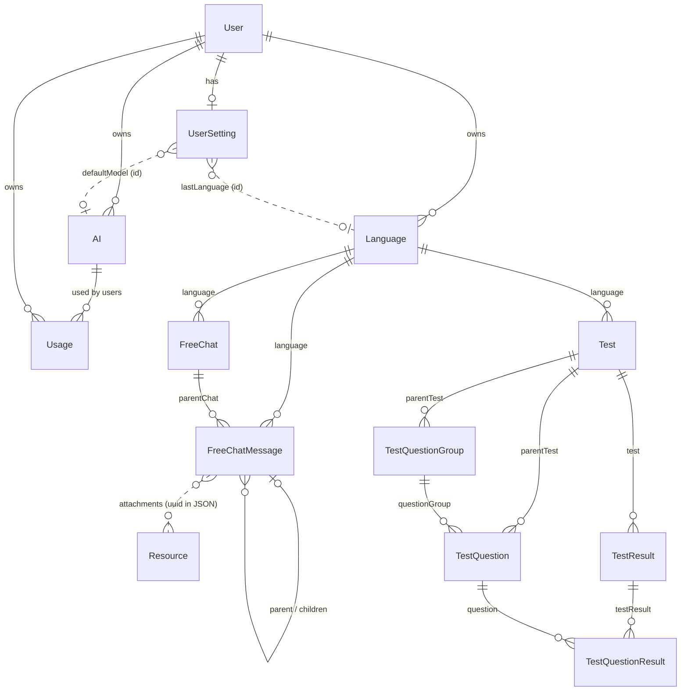
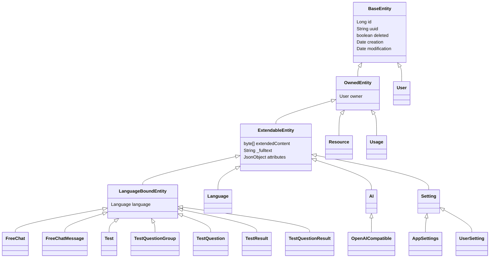

# Domain model

The entities LingoLLM stores, how they relate, and the rules every entity follows: identity, ownership, soft
delete, extended attributes and cleanup. Entities are in `domain/model/` (base classes), `domain/model/impl/` and
`domain/security/model/User.java`. How the tables are created and changed is in [Database & migrations](database.md).

## Names in code and UI

Some entities have a name in the UI that differs from the class. The UI and this manual use the names on the right:

| Class | Table | In the UI |
|---|---|---|
| `Language` | `languages` | Language profile |
| `Languages` (enum) | - | Language (the template of a profile) |
| `FreeChat`, `FreeChatMessage` | `free_chats`, `free_chat_messages` | Free chat, message |
| `Test`, `TestQuestionGroup`, `TestQuestion`, `TestResult`, `TestQuestionResult` | `tests`, `test_question_groups`, `test_questions`, `test_results`, `test_question_results` | Test, its groups of questions, the questions, an attempt at it, the answers of an attempt |
| `AI`, `OpenAICompatible` | `ais`, `ais_openaicompat` | Inference provider |
| `Usage` | `usages` | Tokens sent / generated column of the Inference Providers tab |
| `Setting`, `AppSettings`, `UserSetting` | `settings` | Settings page, admin settings |
| `User` | `users` | User |
| `Resource` | `resources` | Resources tab, attachments of a message |

The language of the interface is **not** an entity: it is `loc.Language`, a record with a code.

## Overview



Every entity except `User` has an owner, so each user has a separate set of language profiles, providers and
settings. The relationships between them never cross users. The dotted lines are not foreign keys: a message keeps the
uuids of its attachments in its extended content, and `UserSetting` keeps ids of the last profile and the default model
(weak cleanup references).

## Base classes



### `BaseEntity` - identity and soft delete

| Field | Column | |
|---|---|---|
| `id` | `id` | Database key, generated by Hibernate (`GenerationType.AUTO`, a `<table>_SEQ` table per hierarchy). Used for relations and inside one installation only. |
| `uuid` | `uuid` (unique) | Stable identity, set on the first save. Used wherever an entity leaves the database or must be found again: URLs (`/view/<uuid>`), backups, exports, imports, extension data. |
| `deleted` | `is_deleted` | Soft delete flag. |
| `creation`, `modification` | | Set by the repository on save. Messages of a chat are ordered by `creation`. |

`equals` and `hashCode` use the `id`, so don't put unsaved entities into hash-based collections.

**Soft delete.** `delete(entity, false)` - the normal delete - only sets `deleted = true`. All finder queries skip
deleted rows, so to the application the entity is gone, but the row stays and other rows can still point at it. The
administrator's *Cleanup* page later purges deleted rows that nothing needs any more (see [Cleanup references](#cleanup-references)).
`delete(entity, true)` removes the row right away; it is used where nothing can reference the row, e.g. replaced
messages during a backup restore.

**A soft delete takes the dependent rows with it.** The services whose entities own other rows override `delete` and,
when it is not a hard delete, soft delete those rows first (the `OWNED_BY` / `OWNS` rows of the
[cleanup references](#cleanup-references)), so the trash and the cleanup see the whole group deleted:

| Deleted | Also deleted |
|---|---|
| `Language` | its `FreeChat`s, `FreeChatMessage`s, `Test`s, `TestQuestionGroup`s, `TestQuestion`s, `TestResult`s and `TestQuestionResult`s (`LanguageBoundService.softDeleteForLanguage`, bulk updates) |
| `FreeChat` | its `FreeChatMessage`s (`FreeChatMessageService.softDeleteForChat`) |
| `FreeChatMessage` | nothing: the messages below it stay, whoever deletes a message in the middle of a chat has to move them to its parent |
| `Test` | its `TestQuestionGroup`s, `TestQuestion`s, `TestResult`s and `TestQuestionResult`s, soft or hard like the test (`deleteForTest` of their services, bulk) |
| `TestResult` | its `TestQuestion`s, soft or hard (`TestQuestionResultService.deleteForTestResult`) |
| `AI` | its `Usage`s |

Objects that only *reference* the deleted one (a default model, the last language profile) are not deleted. A hard
delete does not cascade. Code that adds an entity owned by another one has to add it to the cascade, or the owned
rows stay live while their owner is in the trash.

### `OwnedEntity` - ownership

`owner` (column `userId`) is the user the entity belongs to; `null` for installation-wide rows (`AppSettings`).
`OwnedServiceImpl.save` fills it with the current user when a new entity has no owner. Lookups that start from
user input go through the owner-aware finders:

| Method | Returns |
|---|---|
| `findAllForUser()`, `findAllIdsForUser()` | Non-deleted entities of the current user. |
| `findForUser(uuid)` | The entity with this uuid if it belongs to the current user and isn't deleted, otherwise `null`. |
| `find(id)` | Any entity, regardless of owner and `deleted` - only for ids taken from the user's own data. |

### `ExtendableEntity` - extended attributes

Most of an entity's data is not in table columns but in one JSON document stored in the `extendedContent` blob. Two
kinds of fields end up there:

- fields annotated `@ExtendedAttribute` (they are also `@Transient`, so Hibernate ignores them), and
- `attributes`, a free-form `JsonObject` for extensions. Its keys are stored with the prefix `attributes_` next to
  the other fields. Any `JsonObject` field can be stored this way (so can a POJO, see *Types*) with `@ExtendedAttribute(inject = true,
  injectPrefix = "name")`; `Language.languageSpecificData` does (keys `languageSpecificData_*`), `attributes` is the same
  mechanism.

```json
{
  "note": "evening class",
  "defaults": "{...}",
  "languageSpecificData_kana": "hiragana",
  "attributes_myplugin": { "reviews": [ ... ] }
}
```

`ExtendableEntityListener` converts between the fields and the document:

- **Load** (`@PostLoad`): the JSON is parsed and the fields are set. Supported field types are `String`, numbers,
  `Boolean`, `Date` (ISO-8601 instant in UTC, e.g. `2026-10-09T08:15:30.123Z`; values in the old `yyyy.MM.dd'Z'HH:mm:ss.SSS` format, written in the server's time zone, are still read), enums (by name) and for `inject = true` a `JsonObject` or any class Gson can read (below).
- **Injected POJOs**: an `inject = true` field may also be a class (or a list, map...): it is converted with Gson; an object is flattened by its top-level properties (`prefix_name`), nested parts stay structured, and a value that is not an object (a list) is stored under the plain prefix. A field absent from the content keeps its default value.
- **Types**: the values are written with `toString()`, so a field can't be a collection. A list is kept as a JSON string
  in a `String` field with typed accessors, like `FreeChatMessage.attachments` (`getAttachments()` / `setAttachments(...)`, a JSON
  array of `ImageAttachment(resource uuid, caption)`).
- **Save**: `JpaExtendableRepository.save` serializes the fields into `extendedContent` before the entity is written.

Because the fields are `@Transient`, Hibernate's dirty checking doesn't see them. **A change to an extended attribute
is only stored by calling the service's `save`.** Changing it on a managed entity and letting the transaction commit
does nothing.

`saveWithoutEvent` writes `extendedContent` as it is, without serializing the fields first. It is used when
`extendedContent` was set directly - copying the JSON of a backup into a restored entity - and must not be overwritten
by the (empty) fields. The repository then reads the fields back from the JSON and rebuilds `_fulltext` from them.

## Language profiles and free chats

### `Language` (language profile)

| Field | Stored | |
|---|---|---|
| `language` | column (by name) | The template, `Languages` (`JAPANESE`, `GERMAN`): flag, defaults and the `LanguageUI` factory. Renaming a constant breaks existing data. |
| `nameOverride` | column | The name the user gave the profile. |
| `note` | extended attribute | Free text shown below the name. |
| `userGrade` | extended attribute | The level the user says they have, `CEFR` (`A1`...`C2`, in `domain.collections`; `getDescription()` is a short text for the model). Null until set. |
| `userGradeFineDetails` | extended attribute | Free text on top of the grade (what the user can and cannot do). |
| `defaults` | injected extended attribute (`defaults_*`) | `LanguageDefaults` with the texts (prompt templates) the user changed. A text that is null or blank means the default of the language (`Languages.defaults`) is used; `LanguageService` (e.g. `getGaugeTestPrompt`) resolves it. |
| `languageSpecificData` | injected `JsonObject` | Whatever the language's own UI keeps (progress, settings), stored as `languageSpecificData_*`. |

### `LanguageBoundEntity`, `FreeChat`, `FreeChatMessage`

`LanguageBoundEntity` is a mapped superclass of `ExtendableEntity` with a lazy `language` (column `language_id`, `OWNED_BY`:
the object is purged with its profile). `LanguageBoundService` adds `findAllForUser(language)` and
`findAllIdsForUser(language)`, and `LanguageBoundServiceImpl.save` gives a **new** object without a language the one of the
session, see below.

| Entity | Table | Fields |
|---|---|---|
| `FreeChat` | `free_chats` | `rootPrompt`, `prompt` (extended attributes). |
| `FreeChatMessage` | `free_chat_messages` | `parentChat` (`OWNED_BY`; a column that cleanup sets to null before the purge, so it is nullable), `parent` (the message it answers, `OWNED_BY`; null for the first message), `contents` and `attachments` (extended attributes). |

Tests are language bound too:

| Entity | Table | Fields |
|---|---|---|
| `Test` | `tests` | `name`, `description` (extended attributes). |
| `TestQuestionGroup` | `test_question_groups` | `parentTest` (`OWNED_BY`), `ordinal` (column, the order in the test), `factory` (extended attribute: class name of the `TestQuestionGroupFactory`, resolved by `TestQuestionGroupFactoryRegistry`). What the group shows to all its questions (a text to read, instructions) is kept by its handler under `$groupData` in the attributes. |
| `TestQuestion` | `test_questions` | `parentTest` (`OWNED_BY`), `questionGroup` (`OWNED_BY`), `ordinal` (column, the order in the group; a test is shown by the ordinal of the group, then of the question), `testQuestionFactory` (extended attribute: class name of the `TestQuestionFactory` that handles the question, resolved by `TestQuestionFactoryRegistry`). |
| `TestResult` | `test_results` | `test` (`OWNED_BY`), `score`, `maxScore` (extended attributes). One attempt at a test. |
| `TestQuestionResult` | `test_question_results` | `testResult` (`OWNED_BY`), `question` (`OWNED_BY`), `answer`, `verdict` (`TestVerdict`: CORRECT, PARTIAL, WRONG), `gradedBy` (`GradedBy`: SERVER when the server compared the answer with `TestQuestion.answers`, LLM when the model judged it) and `feedback` (extended attributes). |

What the model writes for a test: every `TestQuestionHandler` returns the JSON schema of its question data
(`getLlmSchema()`, built from the data class with `@LLMField`; override it when the question needs something else) and a
name for the kind (`getLlmTypeName()`, the simple class name). `TestDefinitionSchemaGenerator.generate(handlers)`
(`domain.service.structured`) combines them into the schema of an object with a `questions` list whose items are
`oneOf` the kinds, told apart by the `type` property (a constant, the first property). The order of the list is the order
of the questions; groups are not part of the schema yet.

`Test.reasoning` (extended attribute) keeps what the model reasoned while it wrote the test, for debugging or a curious
user. `BaseLanguageDefinitionService.createTest` writes a test in phases and `createGaugeTest` is the level gauging test
(`gaugeQuestionRequests`: 6 reading and 15 other questions, subclasses add more through `questionsBetweenSections` /
`questionsAtEnd`). Every `TestQuestionRequest` has a kind and a CEFR `level` (spread evenly over A1-C2 in a section by
`spreadLevels`). The requests are cut into batches of three; for each batch the generic prompt of `LanguageDefaults`
(`getCreateTestPrompt`) is rendered with `TemplateService.processTemplate` (Handlebars; `` is the JSON list
of the batch, `` the questions written so far, `` what was wrong with the last answer), and
`InferenceService.infer` is called with the schema of the kinds in the batch and exactly three items. The answer is
checked (schema, the kind and order asked for, `setLlmData` of the handler, the rules of the language); a batch that fails
is asked again up to `MAX_ATTEMPTS` times, then the test fails. When all batches are accepted they are saved as a `Test`,
one `TestQuestionGroup` and the `TestQuestion`s; a failed or cancelled generation saves nothing.

`findByTest` / `findByTestResult` of the services list the children (they refuse a parent of another user). The deletes cascade
as in the table above, hard or soft, with bulk statements.

`FreeChatMessage` attachments are **loose**: the JSON holds `ImageAttachment(resource uuid, caption)`, there is no foreign key to `Resource`,
so deleting or replacing a resource never touches a message (and cleanup does not know the link). The messages of a chat form a
tree through `parent` like the parts of a Marginalia story; deleting a message permanently moves its children to its parent
(`CleanupServiceImpl.moveChildrenOfMessages`). `FreeChatMessageService.findByChat` lists the messages of a chat, oldest first.

### The language of the session

The session-scoped bean `language` (type `Language`, `scope="session"` with a scoped proxy in `container-config.xml`, like
the `user` bean) is only a **reference**: `LanguagePart` fills id, uuid, template and name when the user picks a profile and
clears them when there is none. Code that needs the profile loads the entity by `getId()` through `LanguageService`.
The last profile is also stored in `UserSetting.lastLanguage` so the next login opens it.

```java
@Autowired
private Language currentLanguage; // session bean, id is null until a profile is selected
```

Background threads have no session, see [Threads and push](architecture.md#threads-and-push): the proxy resolves only in a
request or after `ThreadCopyRequestAttributes`.

## Inference providers

They use joined inheritance: a base table with the common fields and one table per type. Today there is one type.

### `AI` / `OpenAICompatible` (inference provider)

| Field | Stored | |
|---|---|---|
| `aiType` | column (ordinal) | `AIType.OPEN_AI_COMPATIBLE`. `InferenceServices` picks the implementation by this type. |
| `name` | column | |
| `maxContext`, `maxCompletionTokens` | columns | Context size and maximum response tokens of the model. |
| `shared` | column (indexed with `deleted`) | An AI of an administrator that every user can use: `AIRepository`'s `findAll(user)`, `findAllIds(user)` and `findByUuid` return the user's own AIs and the shared ones, so `findAllForUser()` / `findForUser(uuid)` see them, as do backup restore and the model combos. Only the owner changes or deletes it and only an administrator sets the flag (`AIServiceImpl`, server side; the UI hides edit, delete and the API key from others). Real column because the lookups filter on it. |
| `enabledReasoning`, `reasoningEffort` | columns | Reasoning settings. |
| `needsJailbreak`, `jailbreak` | columns | Text put before the system prompt. |
| `uri`, `model`, `modelName`, `apiKey` | columns (`ais_openaicompat`) | Base URL, the model id sent to the API, its label in the model list, the API key (encrypted, see [Encrypted columns](database.md#encrypted-columns)). |
| `additionalParameters` | JSON (`additionalParameters_*`) | Extra fields added to every request; they win over the settings LingoLLM sends. |
| `requestTimeoutSeconds`, `maxRetries` | JSON | Wait for the API (read timeout) and retries of a request; `null` = the defaults of `OpenAICompatibleInferenceService` (300 s, 2 retries). |

### `Usage` (tokens used with an AI)

One row per AI and user (`owner`), unique on `(ai_id, userId)`: a personal AI has one, a shared AI one for everybody who
uses it. Counts what the user used, and since the last reset for the user's limit on the AI (below).

| Field | Stored | |
|---|---|---|
| `ai` | column `ai_id` | `@ManyToOne`, `OWNED_BY` the AI for cleanup. |
| `prefillTokens` | column | Tokens sent to the model (the prompt). |
| `generatedTokens` | column | Tokens the model generated, reasoning included. |
| `requests`, `lastUsed` | columns | Number of requests added up, time of the last one. |
| `periodPrefillTokens`, `periodGeneratedTokens` | columns | Tokens sent / generated since the last reset of the user's token limit. Counted only while the user has a `TOKEN_LIMIT` (otherwise set to 0); stale when `lastUsed` is before the start of the current period. |

All are real columns: they are added up in SQL (`UsageRepository.add`, `UPDATE ... SET x = x + :n`), not read and saved, so parallel
requests don't lose counts. `UsageService.record(ai, prefill, generated)` is the way to count: it adds to the row of the
current user, creating it on first use (under a lock held until the commit, so two first uses can't both insert), and
never throws. `findAllForAI(ai)` lists every user's usage for the owner of the AI or an administrator; `findAllUsages()` lists all of them, administrators only (the
**Usage per user** dialog of the Models tab).

`OpenAICompatibleInferenceService` calls `UsageService.record` when a `stream` or `infer` ends, see [Inference](services.md#inference).

#### Limits of the users of a shared AI

`AI.limits` is an `@ExtendedAttribute` string holding a JSON object: the `AILimit` of each user under the user's uuid
(`strategy` `LimitStrategy` UNLIMITED / TOKEN_LIMIT / NOT_AVAILABLE, `resetStrategy` `ResetStrategy` DAILY / WEEKLY / MONTHLY,
and `prefillTokens`, `generatedTokens`, `totalTokens`, each null for unlimited). `AILimits` reads and writes it; a user
without an entry is not limited. These are only the *settings* and they are set by the owner (an administrator). What a user
*used* is not in this JSON on purpose: it changes with every request, from the thread of any user, and `AIService.save` is
for the owner and would lose parallel updates, so it is in the two `period*` columns of the user's `Usage`, added up in SQL
like the other counters.

The reset is lazy. `ResetStrategy.periodStart(now)` is the start of the calendar day / week (from Monday) / month in the
server's time zone. `UsageService.add` (under `record`) of a user with a `TOKEN_LIMIT` first runs
`UsageRepository.resetPeriod` (zeroes the period counters when `lastUsed` is before the period start) and then adds; for a
user without one it zeroes them. `AILimitService.getStatus` does not write: it reports 0 used when `lastUsed` is before the
period start. `LimitStatus.block(promptTokens)` is the first reached of the sent, generated and total limits, or NOT_AVAILABLE. The
prompt is known before the request, so a request is refused when the sent (or total) counter is at its limit or the
estimated prompt (`approximatePromptTokens`, our count) would take it over; the generated counter is only compared with its
limit, so the last response can go over - unless `AILimit.hardGeneratedLimit` is set: then the generated counter plus the
response the request reserves (the AI's `maxCompletionTokens`; 0 when
there is none) has to fit into the generated limit. The hard flag does not apply to the total limit. `AILimit.validate()` rejects negative numbers and, when all three are
set, sent plus generated below the total (the total could never be reached).

!!!warning Enum columns
`AI.aiType` is stored as an **ordinal**: add new values only at the end of `AIType`, never reorder them. All other enums
(`AI.reasoningEffort`, `Language.language`...) are stored by **name**: renaming a value breaks existing data.
!!!

## Settings

`Setting` is one table (`settings`) for all settings classes, with the class name in `DTYPE` and in `key`. Almost all
values are extended attributes.

| Class | Owner | Contains |
|---|---|---|
| `AppSettings` | none (one per installation) | Data versions (`dbVersion`, `appVersion`), the database backup schedule (`backupScheduleEnabled`, `backupSchedule`, `backupKeep`, `lastScheduledBackup`, `backupScheduleChanged`), `userAisAllowed` (users who are not administrators can create AIs, default and `null` = yes; `AIService.setUserCreationAllowed`, checked in `AIServiceImpl.save` for new AIs only, existing ones stay editable). |
| `UserSetting` | each user | The default model (id, `@CleanupReference(WEAK)`), the last language profile (`lastLanguage`, id, `WEAK`) and the code of the language of the UI (`language`, see [Localization](architecture.md#localization)). |

`SettingService.getOrCreate(UserSetting.class)` returns the current user's settings, creating them on first use;
`getOrCreateApp(AppSettings.class)` the installation's. Extensions keep their settings in the `attributes` of
`UserSetting` (Reviewer and Side Query profiles do).

## Users

`User` extends `BaseEntity` directly - it has no owner and no extended attributes.

| Field | |
|---|---|
| `login` | Unique login name. |
| `fullName` | Display name. |
| `passwordHash` | Password hash (`UserServiceImpl`). |
| `savedLogins` | The *Save login* tokens as text, one `identifier;hashedSecret;created;lastAccess` entry per login, separated by `\|` (`PersistedLoginInfo`, read and written by `UserServiceImpl`). |
| `isAdmin` | Administrator. |
| `failedLogins`, `lockedUntil` | Login back-off: consecutive failed logins and the time (epoch milliseconds, `0` = not locked) until which the account refuses logins. Real columns (V7), reset by a successful login, a password change or clear and the administrator's unlock. A separate, in-memory limit per client address is kept by `UserServiceImpl`, not on the entity. |

The current user of a session is the session-scoped `user` bean (see [Architecture](architecture.md#spring-wiring)),
which holds a copy of the logged-in user's id, login and name - load the entity through `UserService` when you need
more.

## Resources

`Resource` (`resources`, an `OwnedEntity`) is an uploaded file, for example an image attached to a chat message
(`FreeChatMessage.getAttachments()`, see [Extended attributes](#extendableentity---extended-attributes)).

| Field | |
|---|---|
| `path` | File name in the user's `images` folder (images) or `resources` folder (other files) of the data folder. The files are stored by content: uploading the same bytes again reuses the file. |
| `hash` | Hash of the content; with the owner it is the key for that deduplication (`ix_resources_user_hash`). |
| `mimeType`, `originalName` | Detected content type and the name the file was uploaded with. |
| `objectId`, `clazz` | Loose link to the object that uses the file (class name and id). Bookkeeping for the Resources tab only - not a cleanup reference, the object may be gone. |

Deleting a resource is a soft delete like any other; files are never deleted from disk.

## Cleanup references

Soft-deleted rows are purged by `CleanupService` (*Admin → Cleanup*, administrators only: every method calls `AdminGuard.requireAdmin()`). Before purging, it builds a graph of all
references between rows and decides what may go. Each reference has a policy (`@CleanupReference`, in
`domain/traits/`):

| Policy | Meaning | Used for |
|---|---|---|
| `STRONG` (default) | The referenced row can't be purged while the reference exists. | (none yet) |
| `OWNED_BY` | The referencing row belongs to the referenced one and is purged with it. | `LanguageBoundEntity.language`; `FreeChatMessage.parentChat`, `.parent`; `Usage.ai`; every `owner` |
| `OWNS` | The referenced row belongs to the referencing one and is purged with it, unless referenced elsewhere. | (none yet) |
| `WEAK` | The reference doesn't block the purge; it is cleared when the referenced row goes. | `UserSetting.defaultModel`, `.lastLanguage` |

JPA associations are found automatically from the Hibernate metamodel and default to `STRONG`. Plain id fields
pointing to other entities ("soft references", including extended attributes) are only seen when annotated with
`target = SomeEntity.class` or, for polymorphic ones, `targetClassField = "clazz"`. On an entity class,
`field = "..."` sets the policy of an inherited field (`OwnedEntity` makes `owner` `OWNED_BY`, so a deleted user
is purged together with everything they own).

### Trash

The same reference model drives the trash (`TrashService`, implemented by `CleanupServiceImpl`; *Trash* tab and
*Admin → Cleanup*). It lists the soft-deleted rows of every root entity that is an `OwnedEntity` (`AI` stands for
its subclasses) with narrow projections - the `extendedContent` blob is only read by `getExtendedContent`, which
pretty-prints it - and restores them with a bulk `UPDATE ... SET deleted = false, modification = now`, so no entity
listener runs and extended attributes stay untouched. Before it restores, it looks up the *parents* of the selected rows:

| Reference | Parent |
|---|---|
| `STRONG`, `OWNED_BY` held by the row | the referenced row (`FreeChatMessage.parentChat`, `LanguageBoundEntity.language`, `owner`...) |
| `OWNS` held by another row | that row |
| `WEAK` | none, purge clears it anyway |

When a parent is deleted and not part of the same selection, nothing is restored and the result lists the blockers.
A deleted owner counts as a parent, so the objects of a deleted user can't be restored.

The restore is the reverse of the [soft delete cascade](#baseentity---identity-and-soft-delete): the selection is first
extended with the deleted rows it owns (`OWNED_BY` rows pointing at a selected row, rows a selected row `OWNS`,
repeatedly), so restoring a language profile brings back its chats and messages, and `RestoreResult.getRestored()` counts
them too. It can't tell a row that was deleted together with its owner from one deleted on its own earlier, so the latter
comes back as well. A restored message whose children were moved to its parent (a permanent delete) does not get them back.

`TrashService.deletePermanently` removes deleted rows for good, for the *Delete Permanently* button of `TrashGrid`. It is
limited to `getPermanentlyDeletableTypes()` (`FreeChatMessage`; anything else raises `IllegalArgumentException`) so a user
can't purge a whole profile, and checks ownership like `restore`. It runs the purge of the cleanup (`executePurge`) on the
selection; a block by a `CleanupContributor` (or any other row that would have to go) makes the whole call return
`DeleteResult.getBlocked()` and roll back. Before that, `moveChildrenOfMessages` moves the children of the selected
messages - deleted ones too - to the nearest ancestor that is not selected, with bulk updates, so removing a chain of
messages keeps the messages below it connected.

So a deleted provider that something still uses shows up as *blocked* on the Cleanup page, while a deleted language
profile takes its chats and messages with it.

Because the soft delete deletes the owned rows too, they are purge roots of their own. A root whose owner (`OWNED_BY`,
directly or through other rows) is blocked is *held back*: it stays, is not listed as blocked itself and is not
counted as purgeable, so a blocked chat that is still restorable keeps its messages.

## Adding a field or an entity

**A field on an existing entity:**

1. Decide where it lives. Prefer an extended attribute (`@ExtendedAttribute @Transient`) - no migration, backed up
   automatically. Use a column only when you need to query, sort or join on it.
2. For a column: add a Flyway migration (see [Database & migrations](database.md)); Hibernate validates the schema on
   start. Extend the backup / restore code if the value should survive a backup.
3. For a reference to another entity: think about its cleanup policy and annotate it if `STRONG` isn't right.
   Soft references (ids) must be annotated with `target` or `targetClassField`, otherwise cleanup may purge the
   referenced row.
4. Save it through the service's `save` (not `saveWithoutEvent`).
5. If its text should be found by a search, annotate it `@Fulltextable`; `ExtendableEntityListener` then collects it into
   `_fulltext` (there is no search UI yet). Existing rows need a migration that refills `_fulltext`.

**A new entity:**

1. Extend `ExtendableEntity` (or `OwnedEntity` if it never needs extended data) and annotate the references.
2. List the class in `src/main/webapp/config/persistence.xml` - unlisted classes are ignored.
3. Write a Flyway migration creating the table, its `<table>_SEQ` table and indexes.
4. Add a repository (`JpaExtendableRepository` subclass) and a service (`ExtendableServiceImpl` subclass), and
   define both beans in `services-config.xml`.
5. Add a CRUD test based on `ExtendableCrudContract` (see [Testing](testing.md)).
6. If it belongs to a language profile, extend `LanguageBoundEntity`, use `JpaLanguageBoundRepository` and `LanguageBoundServiceImpl`.
