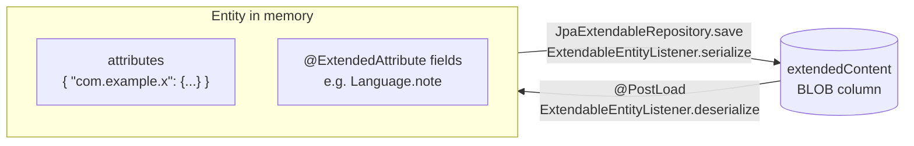

# Extended attributes

Plugins can't add tables or columns - there is no way to run their own Flyway migrations. Instead, every data entity
carries a JSON object where a plugin can keep whatever it needs: `ExtendableEntity.attributes`. It is saved with the
entity, loaded with it, and travels with it into backups.

## Where attributes are

All data entities extend `ExtendableEntity` ([Domain model](../domain-model.md)):

| Entity | Typical plugin data |
|---|---|
| `Language` (language profile) | Per-profile state and settings - the [example plugin](example.md) keeps notes here. |
| `FreeChat`, `FreeChatMessage` | Data about one chat or message - an analysis of a message, a translation. |
| `AI` (inference provider) | Per-provider options. (LingoLLM itself keeps the per-user limits of a shared AI in the `@ExtendedAttribute` field `AI.limits`, see [Domain model](../domain-model.md#limits-of-the-users-of-a-shared-ai).) |
| `UserSetting` | Per-user plugin settings. |
| `AppSettings` | Settings for the whole installation (administrators). |

`User`, `Resource` and `Usage` are not extendable.

```java
JsonObject attributes = entity.getAttributes();       // never null after loading; a new entity starts with {}
```

## Storing and reading data

Use one top-level key per plugin, named after the plugin's package, and put a JSON tree of your own model classes
under it. Follow this pattern:

```java
public class NotesData {
    public static final String KEY = "com.example.lingollm.languagenotes";
    ...
}

public NotesData getNotes(Language language) {
    JsonObject attrs = language.getAttributes();
    if (attrs != null && attrs.has(NotesData.KEY)) {
        return gson.fromJson(attrs.get(NotesData.KEY), NotesData.class);
    }
    return null;
}

public void saveNotes(Language language, NotesData data) throws Exception {
    Language fresh = languageService.find(language.getId());            // load before you change
    fresh.getAttributes().add(NotesData.KEY, gson.toJsonTree(data));
    languageService.save(fresh);
}
```

Rules:

- **Save through the entity's service** - `save(...)`, not `saveWithoutEvent(...)`. See
  [How attributes are stored](#how-attributes-are-stored) for why.
- **Load before you change.** Entities held by the UI are detached copies, and the one you got from a decorator may
  be older than the database. Reload it (`service.find(entity)` or `find(id)`), change the attributes, save it, and
  use the returned object from then on. Saving an old copy overwrites changes made since - to the plugin's data and
  to the rest of the entity.

  When several components edit parts of one JSON tree, each change should re-read the stored tree, change only its part
  and save it, not save a copy it loaded earlier.

- **Version your data.** There are no migrations; if the format changes, read old formats too (a `version` field in
  your JSON tree makes this easy) and never fail on data you don't understand.
- **Keep it small.** The whole JSON object is serialized on every save of the entity, and some entities are saved
  often - a chat message may be saved as it is edited. Megabytes of history in a message's attributes slow the save down;
  keep history in one place (the profile) rather than in every message.

### Settings

- Per user: `settingService.getOrCreate(UserSetting.class)` returns the current user's settings; store under your
  key, save with `settingService.save(userSetting)`. To add the settings to the *Settings* screen, see
  [Extending the UI → Settings panels](ui-extensions.md#settings-panels).
- Whole installation: `AppSettings` the same way, only administrators should change it.

### Keys used by the application

The application itself uses `attributes` too. Don't use these keys:

| Key | Entity | Content |
|---|---|---|
| `languageSpecificData_*` | `Language` | The data of the language itself (`Language.languageSpecificData`, injected with the prefix `languageSpecificData`). |
| `note`, `defaults` | `Language` | The note of the profile and the defaults it was created with. |
| `rootPrompt`, `prompt`, `contents`, `attachments` | `FreeChat`, `FreeChatMessage` | `@ExtendedAttribute` fields of the chats (fields, not `attributes`). |

## How attributes are stored



`attributes` is not a column. The entity has one `extendedContent` column (bytes, UTF-8 JSON), and
`ExtendableEntityListener` converts between the two:

- **On save** (`JpaExtendableRepository.save`) it builds one JSON object: each `@ExtendedAttribute` field of the
  entity under its field name, as a string, and each key of `attributes` with the prefix `attributes_`.
- **On load** (`@PostLoad`) and after every save it fills the fields and `attributes` back from that JSON.

The column of a language profile looks like this:

```json
{
  "note": "evening class",
  "defaults": "{...}",
  "languageSpecificData_kana": "hiragana",
  "attributes_com.example.lingollm.languagenotes": "Verbs of motion next week"
}
```

Two things follow from this:

- `saveWithoutEvent` (used by backup restore, which writes `extendedContent` directly) **does not serialize**:
  changes to `attributes` saved that way are lost. Always use `save`.
- The `_fulltext` column that is written next to `extendedContent` is built only from the application's
  `@Fulltextable` fields. A plugin's `attributes` are not in it and can't be added to it.
- `@ExtendedAttribute` is the application's own way of adding fields to an entity without a migration - many fields
  of `Language`, `FreeChat`, `FreeChatMessage`, `AI` and the settings are stored like this. It works for `String`, the
  numeric types, `boolean`, `Date` and enums, stored as strings (dates as ISO-8601 instants in UTC).
  `@ExtendedAttribute(inject = true, injectPrefix = ...)` on a `JsonObject` field spreads its keys with that prefix,
  which is how `attributes` itself is declared. This is for application code: a plugin can't add fields to an entity
  class, it uses `attributes`.

## Where the data goes

| Operation | Attributes |
|---|---|
| Database backup / restore (*Admin → Database Backups*) | Included - it's the whole database file. |
| Soft delete, restore from the trash | Stay with the entity. |
| Purge (*Admin → Cleanup*) | Gone with the row. |

Plan for the cases where your data does not follow: nothing copies a profile yet, and there is no export of a profile or
a chat, so data on them is only in the database and its backups.

## References to other entities

If your data refers to another entity, store its `uuid` (or `id`). The *Cleanup* page of the administration purges
soft-deleted rows ([Domain model](../domain-model.md)), and it knows only the references the application declares
(`@CleanupReference`) - ids inside a plugin's attributes are invisible to it. Two consequences:

- A deleted entity your data points to can be purged. Always handle a reference that resolves to nothing or to a
  deleted entity. Fall back to another provider when the configured one is missing or deleted:

  ```java
  AI configuredAi = aiService.find(setting.getSelectedAiId());
  if (configuredAi != null && !configuredAi.isDeleted()) {
      return configuredAi;
  }
  return aiService.find(userSetting.getDefaultModel());
  ```

- If a reference must keep its target alive, or must be cleared when the target is purged, register a
  `CleanupService.CleanupContributor`:

  ```java
  cleanupContributor = new CleanupService.CleanupContributor() {
      @Override
      public void collectReferences(Set<CleanupService.EntityKey> candidates, CleanupService.BlockSink sink) {
          // during Analyze / Purge: block candidates the plugin still references
          for (Long aiId : idsOfProvidersMyPluginUses()) {
              CleanupService.EntityKey key = new CleanupService.EntityKey(AI.class, aiId);
              if (candidates.contains(key)) {
                  sink.block(key, "used by My Plugin");      // shown as the reason on the Cleanup page
              }
          }
      }

      @Override
      public void beforePurge(Set<CleanupService.EntityKey> purged) {
          // in the purge transaction, before the rows are removed: drop references to them
      }
  };
  cleanupService.registerContributor(cleanupContributor);    // onExtensionLoad
  cleanupService.unregisterContributor(cleanupContributor);  // onExtensionUnload
  ```

  `EntityKey` uses the root entity class of a hierarchy (`AI`, not `OpenAICompatible`). Cleanup runs for the whole
  installation, not for one user - don't use `currentUser` in a contributor.

When resolving anything that came from data the user can edit or import, use `findForUser(uuid)` so that one user's
data can't point a plugin at another user's entity.
