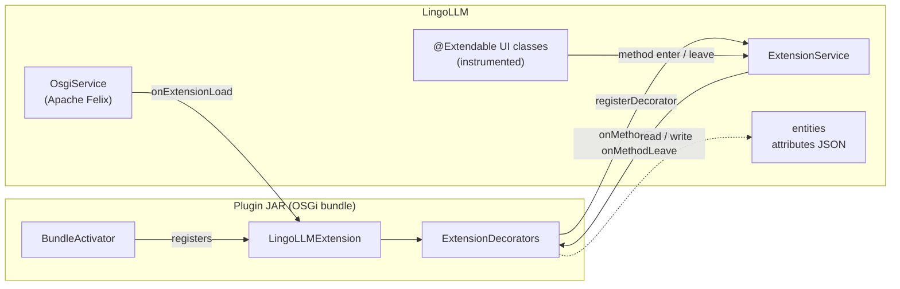

# Plugin development

A LingoLLM plugin (the user interface calls them *extensions*) is an OSGi bundle - a JAR with a few extra manifest
headers - that LingoLLM loads at runtime, without a restart. A plugin can add menu items, tabs, panels and settings
to the user interface, keep its own data on language profiles, chats and user settings, and add languages of the
interface.

This part of the developer guide explains how plugins work and how to write one. It assumes you can build LingoLLM
from source ([Building from source](../building.md)) and know a little Vaadin Flow ([User interface](../ui.md)).

!!!
One plugin comes with LingoLLM, `lingollm/plugins/gemma4toolsfix`, the smallest example (a tool role resolver). The mechanism is the one of [Marginalia](https://github.com/Enerccio/Marginalia),
which has eleven plugins; their code is a good source of patterns, but they hook into Marginalia's classes.
!!!

## How a plugin plugs in

There is no plugin API in the usual sense - no list of extension points with stable signatures. Instead, a plugin
gets general mechanisms and the whole application to use them on:

| Mechanism | What it gives you | Page |
|---|---|---|
| **Bundles** | Loading, unloading, the `LingoLLMExtension` lifecycle, access to every Spring service through `@Configurable`. | [Plugin basics](overview.md) |
| **`@Extendable` hooks** | Code that runs before and after *any* method of an instrumented UI class, with access to its arguments, local variables and fields, and the possibility to replace the return value. | [@Extendable hooks](extendable.md) |
| **Extended attributes** | A JSON object on every data entity where a plugin keeps its data - saved with the entity, included in backups, no schema change. | [Extended attributes](extended-attributes.md) |
| **Languages and styles** | `ExtensionHasLocalization` adds languages of the interface, `ExtensionHasCss` adds CSS to the pages. | [Plugin basics](overview.md#extension-events), [Extending the UI](ui-extensions.md#styles-of-a-plugin) |

[Extending the UI](ui-extensions.md) puts the first three together: adding components, settings panels, threads and
cleaning up on unload. [Example plugin](example.md) builds a small plugin from scratch.

!!!warning Plugins are tied to one version of LingoLLM
Hooks are attached by class and method *name* and read local variables and fields by name. Renaming a method or a
variable in the application silently disables the part of a plugin that used it (a warning is logged). Build plugins
from the same source tree as the application they run in, and test them after every update. LingoLLM itself
[verifies](extendable.md#verification-before-loading) the decorators of an extension before it starts it and refuses
ones that ask for classes, methods, arguments, locals or fields that don't exist.
!!!

Users install plugins as described in [Managing extensions](../../user/administration/extensions.md).

## Reading order

1. [Plugin basics](overview.md) - project layout, the activator and the extension, building and loading.
2. [Example plugin](example.md) - build one, load it, see it work.
3. [@Extendable hooks](extendable.md) - the decorator API in detail and its limits.
4. [Extended attributes](extended-attributes.md) - storing data.
5. [Extending the UI](ui-extensions.md) - patterns for panels, tabs and settings, threads and unloading.
