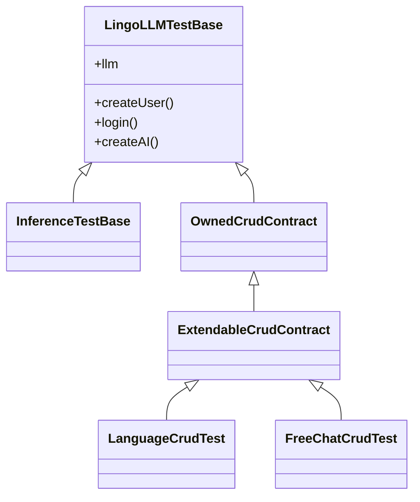

# Testing

LingoLLM's tests are integration tests first: most of them start the real Spring XML configuration against a
throwaway SQLite database and talk to a fake OpenAI-compatible server. They need no network, no model and no API key,
and they run in CI on every push and pull request. This page explains the test infrastructure and how to add tests.

All test code is in `lingollm/src/test/java/com/github/enerccio/lingollm/`; paths below are relative to it.

## Running the tests

From `lingollm/`:

```sh
mvn test                                     # all tests
mvn test -Dtest=LanguageCrudTest             # one class
mvn test -Dtest='*CrudTest'                  # a pattern
mvn test -Dtest='LocalizationTest#name'      # one method
```

Surefire is configured in `pom.xml` with:

| Setting | Why |
|---|---|
| `-XX:+EnableDynamicAgentLoading -Djdk.attach.allowAttachSelf=true` | `RuntimeInstrumentationTest` installs the ByteBuddy agent into the test JVM. |
| `lingollm.test.home=target/test-home` | Folder for the test databases (see [The application folder](#the-application-folder)). |

Reports are written to `target/surefire-reports/`; the CI job uploads them as an artifact when a test fails.

### In the IDE

Tests run from IntelliJ IDEA like any JUnit test, with two conditions:

- the classes must be compiled with AspectJ (see [Building from source](building.md#aspectj-weaving)), otherwise
  UI classes and `@Configurable` beans miss their dependencies;
- add `-XX:+EnableDynamicAgentLoading -Djdk.attach.allowAttachSelf=true` to the VM options of the JUnit run
  configuration template if you run `RuntimeInstrumentationTest`.

Without `lingollm.test.home` the tests fall back to `target/test-home` relative to the working directory, so run
them with `lingollm/` as the working directory (IntelliJ's default for the module).

## Libraries

| Library | Used for |
|---|---|
| JUnit Jupiter 6 | Test engine, `@Test`, `@BeforeEach`, `@TempDir`... |
| AssertJ | All assertions (`assertThat(...)`) - use it instead of JUnit's `Assertions`. |
| Spring Test | `@SpringJUnitWebConfig`, context caching, `@DirtiesContext`. |
| JDK `HttpServer` | The fake LLM server (`test/llm/MockLLMServer`). |

There is no mocking library. Services are tested through the real Spring beans and the real database; the only
fake is the model server.

## What is covered

| Package | Tests | What they check |
|---|---|---|
| `test` | `TestBaseSmokeTest` | The test infrastructure itself: isolated folder, session user, mock LLM wiring (model listing, streaming). |
| `test/llm` | `MockLLMServerTest` | The fake OpenAI server against the real `openai-java` client. |
| `crud` | `*CrudTest`, `OwnedCrudContract`, `ExtendableCrudContract` | Create, update, soft and hard delete, owner isolation and extended attributes of every entity; `FreeChatCrudTest` also checks that a new chat gets the language of the session; `LanguageCrudTest` the injected `languageSpecificData`; `FreeChatMessageCrudTest` the loose attachments and the parent chain. |
| `db` | `DatabaseRestoreCheckTest`, `PreMigrationBackupTest` | The check of a database before a restore (no Spring context) and the copy `Configuration.resolveDb` saves before an existing database is migrated (no history table, nothing for a current or new database, only the newest three kept). |
| `domain` | `ExtendableEntityListenerTest`, `AISharingTest`, `UsageServiceTest`, `AILimitServiceTest`, `CronScheduleTest` | Extended attribute serialization (strings, injected objects, loose attachments), the AIs shared by administrators (visible to all, read-only for others, only administrators share, the setting that stops users from creating AIs), the `Usage` of a user per AI, the limits of the users of a shared AI (the settings, the reset periods and the refusal of a request that is over the limit), cron parsing. |
| `inference` | `InferTest`, `InferenceFunctionCallTest`, `InferenceRobustnessTest`, `InferenceAttachmentsTest`, `UsageInferenceTest` | `infer` (text, schema check, class), `stream` and the model calling functions (tools in the request, results sent back, several calls and rounds, calls answering from other threads, failed and refused calls, the round limit, cancelling while a call is pending, the tool role resolvers); timeouts, retries and the classification of provider errors; attachments as content parts of the request; the usage counted per user (reported or estimated, a failed request not counted). Built on `InferenceTestBase` and the mock server. |
| `function` | `FunctionRegistryTest` | Interfaces become function schemas, arguments are parsed, methods run on the executor and answer through `FunctionContinuation`. |
| `backup` | `DatabaseBackupScheduleTest` | Scheduled database backups. |
| `security` | - | (Marginalia's API key encryption test checked the migration that encrypted plain keys; LingoLLM has none.) |
| `utils` | `ClientAddressResolverTest` | The client address: the header is ignored without trusted proxies and from any other peer, chains of proxies, CIDR ranges, no host name lookups (no Spring context). |
| `loc` | `LocalizationTest` | The language of the session selects the bundle, texts a bundle lacks come from the default language, a language can't be registered twice, the default one can't be removed, `UserSetting.language` is saved (Spring context). |
| `ui.main` | `CssRegistryTest` | The CSS of extensions in the page. |
| `cleanup` | `CleanupTrashTest` | The soft delete cascade (profile → chats → messages), the purge of profiles, chats, providers with their usage, weak references cleared, restore with and without the deleted parent, permanent delete of messages moving their children to the parent, the trash limited to the user's own objects. |
| `instruct` | `ExtendableMethodVisitorTest`, `RuntimeInstrumentationTest`, `ExtensionVerifierTest`, `PublicAPISignatureTest` | The bytecode instrumentation of `@Extendable` methods and the runtime agent; the verification of extensions against the application; the `@PublicAPI` declarations of the `@Extendable` classes. |

Not covered by automated tests: the Vaadin UI (`LanguagePart`, `LanguageCreationDialog` and the workspaces have no
test; they build components that need a UI session), the extension loading on a real OSGi framework (Marginalia has
`OsgiServiceImplTest`, not ported), the full-text query, and the desktop launcher (the
[CI smoke test](packaging.md#continuous-integration) only checks that the packaged app starts).

## Test bases



Pick the lightest base that works:

| Base | Spring | Use for |
|---|---|---|
| none | no | Pure units (`CronScheduleTest`, `ClientAddressResolverTest`, `DatabaseRestoreCheckTest`). |
| `LingoLLMTestBase` | yes | Services, repositories, cleanup. |
| `InferenceTestBase` | yes | Anything that calls an `InferenceService`: a logged in user, an `ai` pointing to the mock server which answers `"generated"` by default. `test/InferenceCollector` is a callback that pulls the whole stream and waits for the end (it records the function calls too). |
| `OwnedCrudContract` / `ExtendableCrudContract` | yes | The CRUD contract of a new entity. |

### LingoLLMTestBase

`test/LingoLLMTestBase` starts the application context from
`src/test/resources/META-INF/spring/test-application-config.xml`. That file imports the production
`application-config.xml` and adds `TestContextPostProcessor`, which

- removes the OSGi framework (`OsgiServiceImpl`) and the instrumentation agent (`RuntimeInstrumentationInitializer`),
- points `Configuration` to a new folder `target/test-home/ctx-<random>/` instead of `~/.lingollm`.

Everything else is the production wiring: the services, Hibernate, Flyway migrations, the session-scoped current
user. The base class gives you:

| Member | |
|---|---|
| `userService`, `aiService`, `inferenceServices` | Autowired services; autowire any other bean in your test. |
| `currentUser` | The session-scoped `User` bean - the "logged in" user of the test. |
| `llm` | A [mock LLM scenario](#the-fake-llm-server) for this test method. |
| `uniqueName(prefix)` | `prefix-1a2b3c4d`, for names that must not collide with other tests. |
| `createUser()`, `createUser(login, password, admin)` | Saves a user. |
| `loginAs(user)`, `login()`, `loginAdmin()` | Makes a user the current user, like a login in the UI (`login()` and `loginAdmin()` create one first). The services that only administrators can use (cleanup, database backups, user delete / unlock / clear password, extension install) need `loginAdmin()`. |
| `createAI()` | Saves an OpenAI-compatible inference provider pointing to `llm`. |

Each test method runs in its own mock HTTP request and session (`@SpringJUnitWebConfig`), so session-scoped beans
start empty: call `login()` before using a service that needs the current user.

#### The shared database

Spring caches the application context, and with it the database, for the whole test run. All test classes that use
`LingoLLMTestBase` share **one** SQLite database. Write tests so that they don't depend on what else is in it:

- create the data a test needs in the test, with `uniqueName(...)` for anything looked up by name;
- assert on the entities you created (`contains`, `doesNotContain`), not on totals (`hasSize`);
- operations that work on the whole database (cleanup, database backups) must only assert on their own data - see
  `CleanupServiceTest`.

When a test really needs an empty database or changes global state, mark it with `@DirtiesContext`. The next test
then gets a new context with a new folder and database:

```java
@Test
@DirtiesContext(methodMode = DirtiesContext.MethodMode.BEFORE_METHOD)   // starts on an empty database
void lastAdminIsProtected() throws Exception { ... }

@DirtiesContext(classMode = DirtiesContext.ClassMode.AFTER_CLASS)        // changes the shared backup schedule
class DatabaseBackupScheduleTest extends LingoLLMTestBase { ... }
```

A new context costs a few seconds (Spring, Hibernate, Flyway), so use it sparingly.

#### The application folder

Each context gets its own folder under `target/test-home/` with the database, data, backup and extension folders.
They are not deleted after the run, so you can open a test database with any SQLite tool after a failure. `mvn clean`
or deleting `target/test-home` removes them.

### CRUD contracts

Every entity that belongs to a user has a CRUD test built from `crud/OwnedCrudContract`. The contract contains the
tests; a subclass only says how to make and change an entity:

| Method | |
|---|---|
| `service()` | The entity's `OwnedService`. |
| `newEntity()` | A new, unsaved, valid entity (referenced entities may be saved). |
| `assertCreated(loaded)` | Checks the fields set by `newEntity()` after a reload. |
| `modify(entity)` | Changes some fields. |
| `assertModified(loaded)` | Checks the changes after a reload. |

The inherited tests check identity and owner on create, find by id / uuid / for user, update (creation date kept,
modification date moved), soft delete (hidden from all `find*ForUser` and `findAll*` methods), hard delete, isolation
between users, and that saving as another user keeps the owner.

Entities extending `ExtendableEntity` use `crud/ExtendableCrudContract`, which adds the persistence of plugin
attributes (`getAttributes()`): nested JSON, changes and removals, unrelated updates, and `saveWithoutEvent`
(used by restore). Put at least one `@ExtendedAttribute` field into `newEntity()` and `modify()`, so the inherited
tests also cover the extended fields. `crud/LanguageCrudTest` is a short, complete example.

When you add an entity (see [Database & migrations](database.md)), add its `<Entity>CrudTest`.

## The fake LLM server

`test/llm/MockLLMServer` is a small OpenAI-compatible server on `127.0.0.1` with a random port, built on the JDK's
`HttpServer`. One shared server lives for the whole test JVM (`MockLLMServer.shared()`); each test gets its own
**scenario** with its own base URL, `http://127.0.0.1:<port>/<scenario-id>/v1`. A provider created with
`createAI()` points to the test's scenario, so tests never see each other's requests or answers.

It answers:

| Endpoint | |
|---|---|
| `GET /models` | The scenario's model list (default `mock-model`; change with `llm.models(...)`). |
| `POST /chat/completions` | Streaming (server-sent events) and non-streaming chat completions. |

### Programming answers

Chat completions are answered in this order:

1. queued responses - `llm.enqueue(...)` or `llm.reply("text")`, one per request;
2. the responder function - `llm.respondWith(request -> ...)`, if set and it returns a response;
3. the fallback - `llm.fallback(...)`;
4. otherwise HTTP 500 *no response programmed*.

`MockLLMResponse` builds one answer:

```java
MockLLMResponse.text("Hello world")                        // one content chunk
MockLLMResponse.chunks("Hel", "lo").chunkDelay(ofMillis(50))
MockLLMResponse.split(longText, 20)                        // chunks of 20 characters
MockLLMResponse.text("answer").withReasoning("thinking")   // reasoning chunks first
MockLLMResponse.text("answer").withReasoning("...").reasoningField("reasoning")  // instead of reasoning_content
MockLLMResponse.text("cut").finishReason("length")
MockLLMResponse.error(429, "slow down")                    // OpenAI-style error body
MockLLMResponse.chunks("a", "b", "c").disconnectAfter(2)   // stream ends abruptly
MockLLMResponse.text("answer").usage(120, 8)               // token counts in the last chunk (only if asked for)
MockLLMResponse.text("late").waitFor(latch)                // held until the latch is released
MockLLMResponse.toolCall("add", "{\"a\":1}")               // the model calls a function; .andToolCall(...) adds one
```

`waitFor(latch)` is the tool for "while generating" states: the request is received, the caller waits for the
stream, and the test can cancel it or inspect the state before releasing the latch.

!!!warning Retries
The `openai-java` client retries 408, 409, 429 and 5xx responses. A queued error response is consumed once per
attempt, so enqueue it several times (or use `fallback`) when a test expects the error to reach LingoLLM. The server
closes the connection after every response, so a retry never reuses a stale pooled connection.
!!!

### Inspecting requests

Every request, including model listing, is recorded:

| Method | |
|---|---|
| `llm.getRequests()`, `llm.getCompletionRequests()` | All requests / chat completions, in order. |
| `llm.lastCompletionRequest()` | The last chat completion; fails the test if there was none. |
| `llm.awaitCompletionRequests(n, timeout)` | Waits for `n` completions - for asynchronous callers. |
| `request.getMessages()`, `getMessages("system")`, `getLastMessage()` | The chat messages (`role`, `content`). |
| `request.getPromptText()` | All messages as `[role]\ncontent` - handy for `contains` assertions. |
| `request.getBody()`, `getRawBody()`, `getModel()`, `isStream()`, `getApiKey()` | The raw payload. |

## Expected errors in the log

Tests of failure paths make the code log errors on purpose. To keep them out of the test output (where they look like
real failures) and to assert on them, capture the logger with `test/ExpectedLog`:

```java
try (ExpectedLog log = ExpectedLog.capture(ExtensionServiceImpl.class)) {   // or capture("extension.my-plugin")
    ...
    assertThat(log.errors()).anyMatch(m -> m.contains("broken"));
}
```

While the capture is open, the logger's events are recorded and not passed to the console; `errors()`, `warnings()`
and `atLeast(level)` return the messages, `entries()` the full events with their exceptions.

## Instrumentation tests

The `instruct` tests check the bytecode that makes `@Extendable` methods extensible (see
[Plugin development](plugins/extendable.md)):

- `ExtendableMethodVisitorTest` transforms fixture classes from `instruct/fixture/` with `instruct/Instrumenter` -
  the same transformation the agent applies, without an agent - and checks that the result verifies, keeps the class
  schema, behaves like the original and exposes arguments and locals to decorators.
- `RuntimeInstrumentationTest` installs the real agent into the test JVM and checks classes loaded both before and
  after the installation (`fixture/agent/`).
- `ExtensionVerifierTest` runs the [extension verification](plugins/extendable.md#verification-before-loading) on
  the extensions of `fixture/verify/VerifyFixtures` (decorators that are valid, ask for things that don't exist, or
  can't be followed) against the decorated `VerifyTarget`. Their class files are packed into a JAR on the fly and
  served by a stand-in `Bundle`. Decorators must be anonymous classes with the context calls inside them, as in a real
  extension - a decorator that delegates to a helper class would not be checked.
- `PublicAPISignatureTest` checks the [`@PublicAPI`](plugins/extendable.md#the-public-api) of every instrumented method
  of every `@Extendable` class of the application against the compiled classes (`target/classes`). It reads them with
  ByteBuddy's type pool and the local variable table (`PublicAPISignatures`), so the application classes are not
  loaded or initialized, and it needs the classes compiled by `ajc` like the application. A failure names the method
  and prints the annotation the method needs.

The fixtures are compiled with the same `-parameters` and `preserveAllLocals` options as the application; if you
change the compiler settings in `pom.xml`, these tests tell you whether extensions still see names of arguments and
locals.

## Checklist for a new test

- Name it `<Subject>Test` and put it in the package of the area it tests; Surefire runs every `*Test` class.
- Extend the lightest base that works ([Test bases](#test-bases)).
- Create your own data with unique names; don't depend on what other tests left in the shared database.
- Don't call real models or other network services - program `llm` instead.
- Assert with AssertJ, with `.as("...")` where the failure message would otherwise be unclear.
- Capture expected error logs with `ExpectedLog`.
- A new entity gets a CRUD contract test; a new migration is covered by `FlywayMigrationTest` automatically (it runs
  all migrations and validates the schema against the entities).
- A bug fix comes with a test that fails without the fix, where the area is testable without the UI.
- Run `mvn test` before opening a pull request - CI runs the same command.
