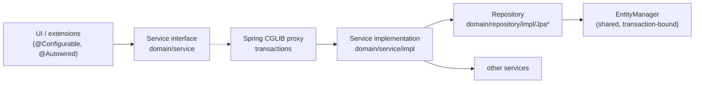

# Services

The service layer holds LingoLLM's logic: everything the UI does to data goes through a service, and services are
the main API extensions use. This page describes how services and repositories are built, how transactions and the
current user work, and what each service is for.

## Layers



- **Interfaces** live in `domain/service/` (and `domain/security/service/`), implementations in `.../impl/`. Code
  always depends on the interface.
- **Beans** are declared in `META-INF/spring/services-config.xml`. Each entity service gets its repository injected
  through the `repository` property; everything else is `@Autowired` inside the implementation.
- **Repositories** (`domain/repository/impl/Jpa*Repository`) contain the JPQL and native SQL. They are called only by
  their service.

## The generic service hierarchy

Entity services extend a generic base that matches the entity's base class:

| Service base | For | Adds |
|---|---|---|
| `BaseService` / `BaseServiceImpl` | `BaseEntity` (`User`) | `find(id)`, `find(entity)` (reload), `find(uuid)` → id, `findAll()`, `findAllIds()`, `save`, `saveWithoutEvent`, `delete(entity, hard)`, `evict` |
| `OwnedService` / `OwnedServiceImpl` | `OwnedEntity` (`Resource`) | Owner-aware finders: `findAllForUser()`, `findAllIdsForUser()`, `findForUser(uuid)`, `findAll(user)`; `save` sets the owner of new entities to the current user. |
| `ExtendableService` / `ExtendableServiceImpl` | `ExtendableEntity` (most entities) | Nothing new - the repository serializes [extended attributes](domain-model.md#extendableentity---extended-attributes) on `save`. |
| `LanguageBoundService` / `LanguageBoundServiceImpl` | `LanguageBoundEntity` (`FreeChat`, `FreeChatMessage`) | `findAllForUser(language)`, `findAllIdsForUser(language)`; `save` gives a new object without a language the one of the session. |

The same three levels exist for repositories: `JpaBaseRepository` → `JpaOwnedRepository` →
`JpaExtendableRepository` (→ `JpaLanguageBoundRepository`). A repository only has to name its entity class (`getEntityClass()`) to get the generic
queries; it can override `hydrate(entity)` to post-process loaded entities.

Things to know about the generic methods:

- **`find(id)` doesn't check owner or `deleted`.** Use it for ids that come from the user's own data (a message's
  `parent`). For anything that comes from outside - a URL, an uploaded file, a backup - use
  `findForUser(uuid)`, which returns `null` for other users' and deleted entities.
- **`find(entity)` reloads.** Entities held by the UI are detached and may be stale; services usually start with
  `Language l = find(language)` before changing it.
- **`findAll*` skip deleted rows**, `find(id)` doesn't.
- **`save` returns the managed copy** (`merge`). Keep using the returned object.
- **`save` vs. `saveWithoutEvent`** - `save` serializes the extended attributes into `extendedContent`;
  `saveWithoutEvent` stores `extendedContent` as it is (used when it was copied from a backup). Both keep the `_fulltext` column
  in step with the `@Fulltextable` fields.
- **`delete(entity, false)`** soft deletes (and, in the services of entities that own other rows - language, chat, message, AI - the owned rows with it), **`delete(entity, true)`** removes the row. See
  [Soft delete](domain-model.md#baseentity---identity-and-soft-delete).

## Transactions

Transactions are declared with three meta-annotations from `domain/traits/` and applied by Spring's
`tx:annotation-driven` with **class-based (CGLIB) proxies** around each service bean (`proxy-target-class="true"`):

| Annotation | Meaning | Typical use |
|---|---|---|
| `@CommonTx` | `@Transactional("common")`, read/write | Methods that change data. |
| `@CommonTxReadOnly` | Read-only transaction | Finders, searches, reports. |
| `@NoTx` | `Propagation.NOT_SUPPORTED` - suspends any transaction | Methods that start background work or do I/O that must not run in a transaction: database backups (`VACUUM INTO`), file operations. |

The rules that follow from proxies:

- **Only calls through a bean reference are transactional.** A service calling its own method (`this.save(...)`)
  bypasses the proxy, so that method's annotation has no effect. When a service needs its own transactional method
  from a callback, it injects itself (`@Autowired private XService self`) and calls `self.save(...)` from the callback.
- **Transactions are short.** SQLite allows one writer at a time (see
  [SQLite limitations](database.md#sqlite-limitations)); a long write transaction blocks every other user's writes.
  Never call a model, wait for the UI or sleep inside a transaction. Code that streams from a model saves through the service for each
  change, so each save is its own transaction.
- **A transaction ends with the outermost annotated call.** Entities returned to the UI are detached. Lazy
  associations (`FreeChatMessage.parent`, `.parentChat`, `LanguageBoundEntity.language`) can't be navigated after
  that - reload them through the service (`find(...)`).
- Methods without an annotation run in the caller's transaction, or without one.

## The current user

Services are singletons, but the user differs per browser session. The session-scoped bean `user`
(`domain.security.model.User` behind a scoped proxy, defined in `container-config.xml`) is injected into services as

```java
@Autowired
protected User currentUser;
```

Each call on `currentUser` is resolved against the HTTP session of the current thread. It holds a copy of the
logged-in user's `id`, `login` and `fullName` - load the entity (`userService.find(currentUser.getId())`) for
anything else, such as `isAdmin()`.

Services that depend on the current user:

- `OwnedServiceImpl` - `findAllForUser`, `findForUser`, and the owner of new entities,
- `SettingService.getOrCreate(UserSetting.class)` - the user's settings,
- `LanguageBoundServiceImpl` - `findAllForUser(language)`, and the language of new objects (from the session's
  `language` bean, below),
- administrator checks: `AdminGuard.requireAdmin()` (see [Administration](#administration)).

**The current language profile** is injected the same way: `@Autowired protected Language currentLanguage;` (the
session-scoped bean `language`, a reference with `getId()` null until `LanguagePart` selects a profile).
`LanguageBoundServiceImpl.save` sets the language of a new object that has none to `languageService.find(currentLanguage.getId())`,
as `OwnedServiceImpl.save` sets the owner. An object that already has a language, or is saved again, is left alone.

**On background threads** there is no request, so resolving `currentUser` fails with *No thread-bound request
found*. Capture the request attributes on the UI thread and enter them on the worker:

```java
ThreadCopyRequestAttributes attributes = ThreadCopyRequestAttributes.create();   // on the UI thread

executor.submit(() -> {
    try (InRequestScope _ = new InRequestScope(attributes)) {                    // on the worker
        languageService.findAllForUser();                                         // current user resolves
    }
});
```

Code that streams from a model on a worker thread does this. Scheduled jobs (database backups) run
without any user and only use installation-wide data (`getOrCreateApp`).

## Services by area

### Models

| Service | Responsible for |
|---|---|
| `AIService` | CRUD of inference providers with rules in the service: the user's AIs are their own and the shared ones (`AI.shared`); `save` / `delete` accept only the owner (`SecurityException` otherwise) and `shared = true` only from an administrator (`AdminGuard`); a new AI needs `canCreate()` (administrators, or anybody while `AppSettings.userAisAllowed`, set by `setUserCreationAllowed`, administrators only). `delete(ai, false)` also soft deletes the usages of the AI. `isOwnedByCurrentUser(ai)` and `isAdministrator()` are for the UI; the latter reads the flag from the database, because the session's `User` bean is filled with id, login and name only, so `currentUser.isAdmin()` is always false in UI code. |
| `UsageService` | `record(ai, prefill, generated)` adds a request to the current user's `Usage` of the AI (never throws, see [Usage](domain-model.md#usage-tokens-used-with-an-ai)); `findForUser(ai)`, `findAllForAI(ai)` (owner of the AI or administrator), `findAllUsages()` (administrator). Called by `OpenAICompatibleInferenceService` after every request, not by the callers of `stream` / `infer`. |
| `AILimitService` | Limits of the users of a shared AI, see [Limits](domain-model.md#limits-of-the-users-of-a-shared-ai). `findLimits`, `setLimit` (shared AIs only, validated by `AILimit.validate()`), `removeLimit`: the administrator who owns the AI only. `getLimit(ai)` / `getStatus(ai)` (`LimitStatus`: limit, tokens used in the period, next reset) are for the current user; the session's `User` has no uuid, so the service loads it. `check(ai, promptTokens, reservedTokens)` (the prompt must fit into the sent and total limits; the generated tokens only count once reached, or with a hard limit together with the reserved response) throws `InferenceException` `NOT_AVAILABLE` or `LIMIT_REACHED`; `OpenAICompatibleInferenceService.stream` and `infer` call it first, so every request is covered. |
| `InferenceServices` | `forAI(ai)` returns the `InferenceService` for a provider. Implementations are listed in `services-config.xml` (`inferenceProviders`), each annotated `@SupportedAI(AIType...)` with a constructor taking the `AI`; the instance is cached on the (transient) `AI.inferenceService` field. `getFunctionRegistry()` is the [`FunctionRegistry`](#function-calls); `addToolRoleResolver` / `removeToolRoleResolver` let an extension change the role the results of function calls are sent with (default `tool`, a Gemma 4 API wants `tool_responses`; `resolveToolRole(ai)` asks the resolvers in the order they were added, the first non-blank answer wins) - the extension must remove its resolver on unload. |
| `InferenceService` | One provider: `getModels()`, `testConnection()` (model list plus a one-token completion, used by the "Test Connection" button of `AIDialog`), `stream(payload, [functions,] callback)` and `infer(payload, [schema or class,] [functions,] callback)`, see [Inference](#inference). Failures of the provider are `InferenceException` (classified by `Type`: authentication, model/URL not found, context overflow, rate limit, server, timeout, connection...; `OpenAICompatibleInferenceService.translateException`); `InferenceErrors.describe(loc, throwable)` / `messageOf` give the localized text for the UI. `OpenAICompatible` has the extended attributes `requestTimeoutSeconds` and `maxRetries`, applied to the client (read timeout, retries with backoff for 408/409/429/5xx and connection errors). Implemented by `OpenAICompatibleInferenceService`. |

### Users and settings

| Service | Responsible for |
|---|---|
| `UserService` | Users: `authenticate` (PBKDF2-HMAC-SHA256 hashes, constant-time compare and the same amount of work for an unknown user, a missing password or a locked account; the first 10 consecutive failures are free, then the account is locked for 1 s, 2 s, 4 s... up to 15 minutes, tracked in `User.failedLogins` / `lockedUntil`; a locked account refuses even the right password; `authenticate(username, password, clientAddress)` also throttles per client address, in memory only: the first 30 consecutive failures from an address are free, then it is blocked with the same 1 s ... 15 minutes back-off for every user name, blocked attempts are not counted against the user, a successful login does not clear the address (otherwise any account holder could reset the count between batches of guesses), entries are forgotten after an hour without failures, the table keeps at most 10,000 addresses (least recently used dropped first) and a restart clears everything; every failure and the moment of a block are logged; see [Login throttling](#login-throttling)), `unlock` (an administrator's *Unlock account* checkbox in `UserDialog`, shown while the user has failures on record: forgets the failures and the lock), `changePassword` (also resets the lock, drops all saved logins and invalidates the user's other open sessions through `SessionManager.runForUsers` - the caller's own session is kept; the current password is checked by `UserDialog` for self edits), `clearPassword` (removes the password, resets the lock, removes saved logins and invalidates the user's sessions except the caller's, an administrator's reset), `isLoginAvailable`, `isLastAdmin` (the last administrator can't be removed or demoted), `deleteUser` (soft delete, frees the login by renaming it to `<login>#<uuid>`, drops saved logins, renames the data folder to `<login>-deleted`; owned data is purged with the user by cleanup), saved logins (`generateNewPersistentInfo`; `authenticateFromCookie` hashes the secret once and compares it with every saved login in constant time, a null user takes the same path; a matched login is rotated). |
| `SettingService` | `getOrCreate(UserSetting.class)` for the current user, `getOrCreate(cls, user)`, `getOrCreateApp(AppSettings.class)` for the installation. |
| `ResourceService` | Files stored by hash in the user's `resources` (or `images`) folder. `uploadImage` stores an attachment (format detected from the content, WebP converted to PNG, 10 MB and 50 megapixel limits), `findImage(uuid)` finds the current user's image. `link` / `unlink` / `describeLink` keep the loose `clazz` + `objectId` note (class name and id of the object using the resource, like `TagRelation`; not a cleanup reference, `describeLink` only checks that the entity exists and is not deleted). `findPageForUser` / `countForUser` serve the lazy table of the Resources tab, `replace` writes a new file and points the resource at it, `softDelete(uuids)` marks resources of the current user deleted (cleanup purges them; files are never deleted). |

### Login throttling

Failed logins are limited twice. Per user (`User.failedLogins`, `lockedUntil`, in the database) and per client address
(`UserServiceImpl.addressFailures`, in memory). Both use the same back-off, 1 s, 2 s, 4 s ... up to 15 minutes, after
10 (user) or 30 (address) consecutive failures; the address limit is higher because several users can share an address.
A failure counts against the address whatever the user name was, so a password spray over many accounts is stopped
even though no single account fails often.

The address comes from `UIUtils.clientAddress(Configuration)` (`LoginCheckRoute.clientAddress()` in the login routes),
which asks `ClientAddressResolver`:

- The address of the connection is used by default. `X-Forwarded-For` is **ignored**, because any client can send it.
- When `trustedProxies` (`configuration.properties`, or `-DtrustedProxies=...`) lists the connecting peer - addresses or
  CIDR ranges - the header is read from the right and the first address that is not a trusted proxy is the client.
  Entries left of it were sent by the client and are never used. The private network is not trusted by itself.
- Host names are never resolved and a bad `trustedProxies` entry stops the start.

Without a proxy nothing needs to be configured. Behind one, list the proxy, otherwise all users share its address
and 30 failures from anyone block everybody for a while.

### Administration

The services behind the Administration screen check on the server that the caller is an administrator, so they stay
safe if something other than that screen (an API, an extension) ever reaches them. They call
`AdminGuard.requireAdmin()` (bean in `services-config.xml`), which loads the current user from the database - the
session copy of `admin` is not trusted, a user demoted or deleted mid-session loses access at once - and throws
`SecurityException` for nobody, a deleted user or a non-administrator. Guarded: every `DatabaseBackupService` method
except `createScheduledBackup` and `getNextScheduledBackup`, `CleanupService.getReferenceModel/analyze/purge`,
`OsgiService.installPackage/uninstallPackage`, and `UserService.deleteUser/clearPassword/unlock`. Code that runs
without a request (the backup schedule, loading extensions on start, `registerContributor`) is not guarded, and
inside these services it calls private unguarded variants (`listBackups`, `removeBackup`). A new administrator-only
service method calls `adminGuard.requireAdmin()` first.

| Service | Responsible for |
|---|---|
| `DatabaseBackupService` | Database backups with `VACUUM INTO`, upload, staged restore, the cron schedule (`CronSchedule`, Spring `ThreadPoolTaskScheduler`) and its rotation. See [Database backups and restores](database.md#database-backups-and-restores). |
| `CleanupService` | `analyze()` builds the plan of what can be purged (from the Hibernate metamodel and `@CleanupReference`s), `purge()` executes it. Extensions with their own references register a `CleanupContributor` (`collectReferences` to block purges, `beforePurge` to clean up). See [Cleanup references](domain-model.md#cleanup-references). |
| `TrashService` | The trash: lists soft-deleted objects (`find`/`count` with a `TrashFilter` of owner and type), shows their extended content as JSON and restores them. Implemented by `CleanupServiceImpl` (same bean as `CleanupService`) because it needs the cleanup reference model. Not administrator-only: a user is limited to their own objects, an administrator (`AdminGuard.isAdmin()`) sees and restores everything, and objects of others raise `SecurityException`. `deletePermanently` removes deleted chat messages for good (children of a removed message move to its parent). `restore` also restores the deleted objects the selection owns (messages of a chat...) and is all or nothing: an object that depends on a deleted object outside the selection (`STRONG` and `OWNED_BY` references it holds, and the `OWNS` reference of the object that owns it) blocks the whole restore, see `RestoreResult.getBlocked()`. See [Trash](domain-model.md#trash). |
| `OsgiService`, `ExtensionService` | Loading extensions and the `@Extendable` decorators (which read arguments and locals and can replace the return value of the decorated method), see [Plugin development](plugins/index.md). `OsgiService` also stops and starts extensions without uninstalling them (`stopExtension` / `startExtension` / `isStopped`, the `<jar name>.STOPPED` flag next to the JAR), gives the SHA-256 of an extension's JAR (`getSha256`, cached until the file changes) and gives each extension its own logger: `createLogger(bundle)` returns an SLF4J logger (implemented by `ExtensionLogger`) that appends to `<jar name>.log` in the extensions folder (moved to `.log.old` over 2 MB) and chains each line to the application log (logger `extension.<name>`); `readLog` / `clearLog` serve the Admin page. See [Logging](plugins/overview.md#logging). |

## Inference

`InferenceServices.forAI(ai)` returns the client of a provider. Everything below is asynchronous: the call returns a
`CancellationToken` at once and reports on a worker thread through a callback. Before anything is sent the user's limit is checked
(`AILimitService.check` with the estimated prompt and the response the AI reserves, `InferenceException`
`NOT_AVAILABLE` / `LIMIT_REACHED`); when the request ends the tokens are counted for the user who started it
(`UsageService.record`, the provider's numbers or a local estimate by `TokenEstimator`; a request that failed before any
text arrived is not counted). The payload is a list of `LLMChatMessage` (role `SYSTEM`, `USER`, `ASSISTANT`, text and,
for a user message, `LLMAttachment`s - images, WAV/MP3 audio, files); sampling settings come from the `AI` (response
limit, reasoning effort, additional parameters) - there is no protocol entity.

| Call | Callback | Result |
|---|---|---|
| `stream(payload, callback)` | `InferenceAsyncCallback` | Chunks (`REASONING`, `RESPONSE`) delivered one at a time: the next one comes only after `controller.continueInference()`; then `onCompletion`. |
| `infer(payload, callback)` | `InferenceResultCallback` | The whole text; reasoning is not part of it. |
| `infer(payload, schema, callback)` | `InferenceResultCallback` | The text and a `SchemaCheck`: the provider is asked to follow the JSON schema (response format) and the answer is checked against it either way, an invalid answer is still delivered. |
| `infer(payload, Class<T>, callback)` | `TypedInferenceCallback<T>` | An instance of the class: the schema is built from its fields (`StructuredOutputs.schemaOf`, `@LLMSchema`, `@LLMField`), an answer that doesn't match ends in `onError` with a `StructuredOutputException` holding the answer. |
| `stream(payload, schema, functions, callback)` | `InferenceAsyncCallback` | Like `stream`, and the provider is asked to answer in the JSON schema (`response_format`, not strict). Only passed on: the chunks are delivered untouched and nothing is validated, the caller does it (`StructuredOutputs.validate`). |

All of them end in `onCancel` (the token was cancelled or `isDead()` is true) or `onError` (an `InferenceException` for a
failure of the provider) instead of the result when something else happens.

### Function calls

Each of the calls above has a variant with a `FunctionSet`: the model may call Java methods on the way. A function is a
method of an interface that is asynchronous - its first parameter is a `FunctionContinuation<R>` that the implementation
completes (from any thread) with the result or fails - and annotated `@LLMFunction`, its other parameters `@LLMParam`:

```java
interface Cast {

    @LLMFunction(description = "Looks up a character")
    void lookup(FunctionContinuation<String> done, @LLMParam(description = "Name") String name);
}

FunctionSet functions = inferenceServices.getFunctionRegistry().bind(Cast.class, (Cast) (done, name) -> done.complete("..."));
inferenceServices.forAI(ai).infer(payload, functions, callback);
```

`FunctionRegistry` compiles an interface once (`FunctionCompiler`: JSON schema of the parameters, validation of the method
shape) and `bind` makes a `FunctionSet` of an implementation. When the model ends its answer with calls, the service runs
them as a chain (each on a thread of its own, the first answer of a call wins), appends the calls and their results to its
copy of the payload (the list passed in is not changed), asks the model again and goes on until it answers without a call,
at most `MAX_FUNCTION_ROUNDS` times; in the last round the model is told not to call anything. A failed or refused call is
reported to the model as an error text. The callback gets one continuous stream (or one result) and `onFunctionCall(call,
result, failed)` for each call. A service that can not call functions throws `UnsupportedOperationException`.

### Callbacks and threads

Callbacks run on worker threads: UI code in them must use `ui.access(...)` (see
[Threads and push](architecture.md#threads-and-push)), and service calls need the request scope shown
[above](#the-current-user); `ThreadCopyRequestAttributes` is captured when the request starts for the usage count.

## Writing a new service

1. Interface in `domain/service/`; for an entity extend `ExtendableService<Entity, EntityRepository>`.
2. Implementation in `domain/service/impl/` extending `ExtendableServiceImpl<...>`; repository extending
   `JpaExtendableRepository<Entity>` with `getEntityClass()`.
3. Beans in `services-config.xml`:

   ```xml
   <bean id="notebookRepository" class="com.github.enerccio.lingollm.domain.repository.impl.JpaNotebookRepository">
       <property name="entityManager" ref="em"/>
   </bean>

   <bean class="com.github.enerccio.lingollm.domain.service.impl.NotebookServiceImpl">
       <property name="repository" ref="notebookRepository" />
   </bean>
   ```

4. Annotate every public method: `@CommonTx`, `@CommonTxReadOnly` or `@NoTx`.
5. Use `currentUser` for ownership, `findForUser(uuid)` for anything coming from outside, and call
   `AdminGuard.requireAdmin()` for administrator operations - hiding a button in the UI is not a permission check.
6. Keep the class non-final with public methods (CGLIB proxies subclass it).
7. Test it on top of `LingoLLMTestBase` (see [Testing](testing.md)).

Extensions can't add beans to the application context. They keep their logic in their own classes annotated
`@Configurable` (plugins are compiled with the AspectJ compiler too), which get the application's services
`@Autowired` - for example the Reviewer's `ReviewerService`. Transactions then come from the application services they
call. See
[Plugin development](plugins/index.md).
