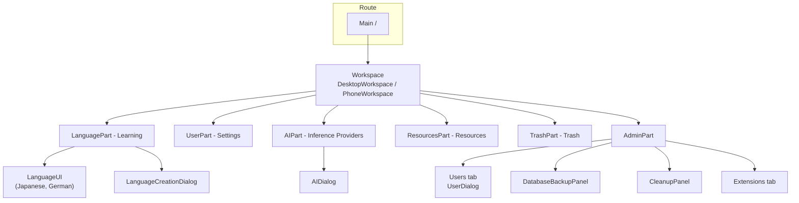

# User interface

LingoLLM's UI is written in Java with [Vaadin Flow](https://vaadin.com/docs/latest/flow) 25: the component tree
lives on the server, the browser renders it with Vaadin's web components (Lumo theme, dark color scheme) and sends
events back over HTTP and a push WebSocket. There is no hand-written frontend code apart from one CSS file. This page
explains how the UI code is organized and the conventions to follow when you change it. The code is in `ui/`.

## Structure



| Package | Contents |
|---|---|
| `ui.main` | `AppShellConfig`, `LingoLLMServlet`, `WebappApplicationInitializer`, `LoginCheckRoute`, `Main`, `CssRegistry`. |
| `ui.workspace` | `Workspace` (interface), `DesktopWorkspace`, `WorkspaceComponent` (a tab), `LanguageUI` / `LanguageUIBase` (a tab sheet of `LanguageUIComponent`s: `GradeUIComponent`, `FreeChatComponent`). |
| `ui.workspace.parts`, `.admin` | One class per tab, and the admin panels. |
| `ui.workspace.phone`, `.parts` | `PhoneWorkspace` and the phone specific tabs. |
| `ui.lang`, `ui.lang.languages` | The learnable languages: defaults, flags, one `LanguageUI` each. |
| `ui.dialogs` | Entity dialogs and generic dialogs. |
| `ui.components` | `MessageImages`, `ThreadCopyRequestAttributes`. |
| `ui.widgets` | Small reusable widgets, among them `TrashGrid` (see [Trash](#trash)) and `LanguageItem`. |

## The shell, routes and login

- `AppShellConfig` (`AppShellConfigurator`) sets up the page once: `@Push`, Lumo stylesheet, `@ColorScheme(DARK)`,
  full-viewport body, `shared-styles.css`, page title, PWA metadata.
- `LingoLLMServlet` is the `VaadinServlet` mapped to `/*` (with `asyncSupported` for push).
- There is one route, `/` → `Main`, which extends `LoginCheckRoute`.

`LoginCheckRoute` runs in the route's constructor (`showLogin()`):

1. On an empty installation it opens `UserDialog` in *first time* mode (create the administrator) and reloads.
2. Otherwise it tries a user that is already logged in this session (`authenticatedSessionUser`, overridden by `Main`: the page was reloaded, e.g. by the language selector) and then the *Save login* cookies (`authenticateFromCookie`, rotating the secret on success), then the user of the start argument
   `-Dlingollm-autologin=<login>` (`Configuration.AUTOLOGIN_PROPERTY`, desktop launcher option
   `--lingollm-autologin`) when `UserService.canAutologin` agrees: it exists, is not locked and has **no password**
   (`autologinUser`; with a password the login screen is shown).
3. Otherwise it shows a `LoginOverlay` (`PermissiveLoginOverlay` - allows empty passwords to reach the server-side
   check) with the *Save login* checkbox.
   The check passes the client address (`LoginCheckRoute.clientAddress()`) to `UserService.authenticate`, which
   throttles failed logins per address (see [Login throttling](services.md#login-throttling)).
4. After a successful login it calls `VaadinService.reinitializeSession` (new session id) and the subclass's
   `proceedWithLogin(login)`, which fills the session-scoped `user` bean, registers the login with
   `SessionManager.userLoggedIn` (see [Sessions](architecture.md#sessions)), sets the language of the session from
   the user's settings ([Localization](architecture.md#localization)) and builds the content.

Logout deletes the cookies, closes the Vaadin session, invalidates the HTTP session and redirects to the context
root. Cookie names include the context path and the route class.

## Building blocks

### Classes that build components

Most UI classes are **not** Vaadin components themselves. They are plain classes with a `create()` method that builds
and returns the component tree, and keep references to the fields they need later:

```java
@Configurable
@Extendable
public class LanguagePart implements WorkspaceComponent {

    @Autowired
    private Localization loc;

    @Autowired
    private LanguageService languageService;

    private ComboBox<Language> languageCombo;

    @Override
    public Component create() throws Exception {
        VerticalLayout layout = new VerticalLayout();
        ...
        return layout;
    }

    @Override
    public void refresh() throws Exception { ... }
}
```

This shape is deliberate:

- **`@Configurable`** - the class is created with `new`, and the AspectJ-woven configurer injects its `@Autowired`
  fields (services, `Localization`, the session `User` and `Language`). See [AspectJ weaving](building.md#aspectj-weaving).
- **`@Extendable`** - the class is instrumented at startup so extensions can run code before and after any of its
  methods and read its local variables (see [Extensions](#extension-points)). Small methods with descriptive local
  variable names (`menu`, `toolbar`, `headerLayout`) are what make a class easy to extend.

Dialogs (`AIDialog`, `UserDialog`, `LanguageCreationDialog`...) extend Vaadin's `Dialog` but follow the same pattern:
construct, call `create()`, then `open()`.

### The workspace

`Workspace` is the interface of the top-level layout shown after login (`create`, `refresh`, `setNavigationLocked`,
`isNavigationLocked`, `getOnLogout`, `setOnLogout`). `Main`, the parts, `ApplicationPoint` and `SessionInformation`
only depend on this interface. `DesktopWorkspace` is the implementation (`@Configurable`, `@Extendable`): it builds an
`HTabSheet` (tabs on the left, a footer with *Admin*, the language selector, *Change Password*, *Logout*) and creates all tab components up
front. Each tab is a `WorkspaceComponent`:

| Method | Called |
|---|---|
| `create()` | Once, when the workspace is built. |
| `refresh()` | To reload data (after login, after changes elsewhere). |
| `onTabSwitched()` | When the tab becomes active - parts reload their lists here. |
| `onTabClosed()` | When another tab is selected. |

`Workspace.setNavigationLocked(true)` disables the other tabs and the *Admin* and *Logout* buttons, so the user can't
leave the active tab. `UserPart` locks it while the settings have unsaved changes: it listens to every `HasValue`
in its layout (extension settings panels included) and unlocks on *Save*, *Discard Changes* or `refresh()`.

`Main.proceedWithLogin` picks `PhoneWorkspace` instead when the body of the page is narrower than 768 px
(`ExtendedClientDetails.getBodyClientWidth()`). The choice is made once per login: resizing or rotating the device
does not switch the workspace until the page is reloaded. `PhoneWorkspace` replaces the left-hand tab sheet with an
`AppLayout`: the parts are listed in a drawer whose footer holds the language selector, *Change Password* and *Logout*,
and the active part fills the screen. **There is no *Admin* button and no `AdminPart`** on a phone; the services still
check `AdminGuard.requireAdmin()` themselves. The user manual describes this in [Using LingoLLM on a
phone](../user/phone.md). `PhoneAIPart`, `PhoneTrashPart` and `PhoneSettingsPart` are phone specific; `LanguagePart` and
`ResourcesPart` are shared.

### The Learning tab and the language profiles

`LanguagePart` is the first tab. Its header is a `ComboBox<Language>` of the user's profiles (rendered by `LanguageItem`:
flag, name, note) and a **+** button that opens `LanguageCreationDialog`. Below it is the component of the `LanguageUI`
that the template of the selected profile creates, `Languages.create(workspace)`.

- `refresh()` loads the profiles, selects the open one, or the one in `UserSetting.lastLanguage`, or the first; with no
  profile it clears the session language and opens `LanguageCreationDialog` with `setFirstTime(true)` once - the dialog
  has no cancel button and does not close on Esc or a click outside (the initial setup).
- `selectLanguage(language, remember)` is the one place a profile is chosen. It fills the session-scoped `language`
  bean (`selectSessionLanguage`), optionally saves `UserSetting.lastLanguage`, and creates the `LanguageUI` if the
  profile changed (`onTabClosed` of the previous one first).
- Every selection change goes through the session bean, so services of language bound entities
  (`LanguageBoundServiceImpl.save`) put what the user creates into the selected profile.

A `LanguageUI` (`getIcon`, `getLanguage`, `setLanguage`, plus the `WorkspaceComponent` methods) is the screen set of one
language. `LanguageUIBase` supplies the plumbing and an empty `create()`; `Japanese` and `German` extend it and are the
place to add exercises. To add a language: a constant in `Languages` (flag from `LanguageIcons`, defaults from
`LanguageDefaults`, the `LanguageUI` constructor), its `ENUM_LANGUAGE_*` key in `L`, `LocalizationBundleEN` and
`LocalizationImpl.loadMaps`.

### The grade test and the test dialog

`GradeUIComponent.takeGradeTest()` picks the AI (`UserSetting.defaultModel` if the user can use it, the only AI, or a
`ListSelectDialog`), then `generate`: it opens the modal `TestGenerationDialog` (it blocks the rest of the UI; a progress
bar, "written / left" and **Stop Generation**) and calls `LanguageDefinitionService.createGaugeTest` (written batch by
batch; `TestCallback.onProgress(done, total)` counts questions, first with 0, and moves the bar; the definition comes
from `LanguageUIBase.getDefinition()`). The callbacks run on a thread of the inference, so they go through `ui.access`
inside `InRequestScope`; a generation number makes the answer of a stopped generation harmless (a test that arrives after
the stop is deleted).

The test that was written is started with `TestResultService.start(test)`, which creates the `TestResult` at once
(`finished = false`), and opened in a `TestDialog(test, result)`. With a result the dialog records the answer of a question
when it is left (**Next**, **Previous**, the close button; `TestQuestionResultService.record` writes the first answer and
rewrites it when the learner goes back) and sets `finished` on **Finish**. A dialog opened on a result with answers puts
them back (`TestQuestionHandler.setAnswer`, the opposite of `getAnswer`) and starts at the first question without one. While
`TestResultService.findUnfinished(language, TestType.GRADE)` finds an attempt, `GradeUIComponent` shows **Continue Grade
Test** and **Discard Grade Test** (a hard delete of the test, which takes its attempts and answers with it) instead of
**Take Grade Test**; `TestDialog.setOnClose` makes it look again when the dialog is closed.

`TestDialog` loads the questions (`TestQuestionService.findByTest`), makes a handler per question with the
`TestQuestionFactoryRegistry`, renders each once (`TestQuestionHandler.render()`; the handler keeps its inputs and
`getAnswer()` reads them) and shows one at a time with the output of `TestQuestionGroupHandler.render()` above it. An
**I don't know** check box disables the rendered question and the answer becomes `dontKnow`. The size is set from Java
(`sizeForScreen`: the whole screen when the body is narrower than 768 px, as for the choice of the workspace): in
Vaadin 25 the overlay is inside the shadow DOM of the dialog, so a style sheet rule can't size it.

`LanguageStringComponent` draws a `LanguageString`: the metadata of a kind with an `Annotator` (furigana as `ruby`)
over the text it covers. An `AnnotationFilter` hides annotations - `KanjiReadingHandler` hides the furigana over its
target kanji with `Furigana.hideOver`. The text goes into the DOM as text nodes, never as HTML.

### Grids

Lists of entities use Vaadin `Grid` with a lazy data provider. `BackendTableProviderBase` (in `ui.widgets`) is the
common base: the owning part searches for the ids to show, passes them with `setIds(ids)`, and the provider loads only
the entities of the visible page (`service.find(id)`) and wraps them in a `BackendTableItem` subclass. It also tracks
checked rows. `ResourcesPart` is a lazy grid over `ResourceService.findPageForUser`.

### Widgets

| Widget | Used for |
|---|---|
| `HTabSheet` | The workspace's left-hand tab sheet with a footer area. |
| `LanguageSelector` | The language combo box of the workspace footers (language of the **interface**): saves the choice in `UserSetting.language`, sets `SessionPoint.language` and reloads every page of the user ([Localization](architecture.md#localization)). |
| `LanguageItem` | `create(loc, template)` / `create(loc, profile)`: the flag with the name (and the note). `label(loc, profile)` is the text of a profile. |
| `TextAreaPopoverComponent`, `TextFieldPopOverComponent` | Long and short fields with a hints popover. |
| `ScrollPanel`, `HtmlText` | Scrollable container; text with HTML. |
| `ResizableTextArea` | `ResizableTextArea.install(loc, textArea, "160px")`: a corner icon toggles between the fixed height (with a scrollbar) and a height that fits the whole content. |
| `TrashGrid` | Deleted objects with a restore button and a button that deletes messages for good, see [Trash](#trash). |
| `Notification` | `Notification.success(...)` / `error(...)` with LingoLLM's durations and variants. |

### Trash

`TrashGrid` is a self-contained widget (`@Configurable`, create it with `new TrashGrid(allUsers).create()`) over
`TrashService`: a lazy multi-select `Grid<TrashItem>` (items identified by their `EntityKey`, so the selection
survives paging), a filter by type (names from `Localization.localizeDomainObject(Class)`) and, with `allUsers`, a
filter by owner and an owner column. `allUsers` only decides what the widget shows; the service decides what the
current user may see and restore. *Restore Selected* confirms and calls `TrashService.restore`; when it returns
blockers the widget shows them in a dialog (nothing was restored), otherwise it refreshes and runs the listeners from
`addRestoreListener` (`TrashPart` uses it to refresh the whole workspace). *Delete Permanently* is enabled while the
selection has only types of `TrashService.getPermanentlyDeletableTypes()` (chat messages), confirms and calls
`TrashService.deletePermanently`, shows the reasons in a dialog when it is blocked and refreshes the table otherwise.
The *Extended Content* link opens the JSON from `TrashService.getExtendedContent` in a read-only text area. `TrashPart`
(the *Trash* tab, `allUsers` for administrators) and `CleanupPanel` (a `Details` section, created when first opened) both
use it.

`PhoneTrashGrid` (used by `PhoneTrashPart`) subclasses it through the `createToolbar()` and `addColumns()` hooks: the
filters are stacked over the whole width, the description is behind an info button, and the table has one content
column.

Generic dialogs: `ConfirmDialog.show(message, onYes)`, `TextInputDialog.Builder`, `ListSelectDialog`,
`ErrorDialog` (message and expandable stack trace). `ExtensionLogDialog.show(bundle, name)` is the read-only, monospace
view of an extension's log. `UsageDialog.show()` is the read-only table of every user's `Usage` (administrators).
`AILimitsDialog.show(ai)` is the table of the limits of a shared AI with add / edit (`AILimitEditDialog`) / delete,
`AILimitInfoDialog.show(ai)` the current user's limit and usage of it.

## Conventions

### Text

Never hard-code user-visible text. Add a key to `loc/L.java` and the text to `LocalizationBundleEN` (and to any other
bundle), and use `loc.getValue(L.KEY)` (`Localization` is injected into every UI class). Date formats come from the same
bean (`loc.getDateFormat()`...). The name of a kind of entity (language profile, chat...) is
`loc.localizeDomainObject(entityClass)`; it falls back to the closest known superclass, then to the simple class name, so
a new entity type needs a mapping in `LocalizationImpl.loadMaps()`. The texts are in the language of the user's session,
so never keep a text in a field that outlives the page or the request - look it up when you show it
([Localization](architecture.md#localization)).

### Errors

Wrap event handlers in `try`/`catch` and report unexpected exceptions with
`UIUtils.internalServerError(loc, e)` - it logs the exception and opens an `ErrorDialog` with the stack trace.
Expected problems (validation, missing configuration) are shown with `Notification.error(...)` or a message next to
the field; `UIUtils.showValidationErrors(loc, e)` formats a binder's `ValidationException`. Failures of a request to the
model API (`InferenceException`: wrong key, wrong URL, timeout...) go through `UIUtils.inferenceError(loc, e)`, which
shows the localized cause (`InferenceErrors`) as a notification and falls back to `internalServerError` for anything
else. `AIDialog` has the *Test Connection* button (`InferenceService.testConnection()` with the values of the form) and,
for administrators only, the *Shared with all users* checkbox. `AIPart` / `PhoneAIPart` list the user's AIs and the
shared ones with the user's own `Usage` (tokens sent / generated); the edit and delete buttons are only shown for AIs the
user owns (`AIService.isOwnedByCurrentUser`) and the add button only when `AIService.canCreate()`. The service refuses
the same things itself. Rows of shared AIs have an *info* button (`AILimitInfoDialog`), and the owning administrator a
*Limits* button (`AILimitsDialog`, `AILimitService`). `AIPart` also has a *Usage per user* button, visible to
administrators only, that opens `UsageDialog`; the service checks the administrator itself.

### Saving

Forms either save automatically (value change listeners call an `autosave()` method of the part, guarded so that
loading values into the fields doesn't trigger a save) or have an explicit *Save*, as the *Settings* tab does.
`LanguageCreationDialog` saves on *OK*. Entities held by the UI are detached copies - reload them through the service
before changing them, and keep the object returned by `save`.

### Background work and push

Vaadin component state may only be touched on a thread holding the session lock. The rules:

- Long work (requests to a model, backups, imports) runs on another thread; the UI thread returns immediately.
- Updates from that thread go through `ui.access(() -> ...)`, with the `UI` captured on the UI thread
  (`UI.getCurrent()` is `null` elsewhere). `UIPushGuard.push(ui)` sends them right away.
- Service calls on that thread need the user's request scope - capture `ThreadCopyRequestAttributes.create()` on the
  UI thread and wrap the work in `InRequestScope` (see [The current user](services.md#the-current-user)).

### Browser-side code

Prefer Java components. When the browser has to do something (scroll positions, element sizes), the script is a
static method of `ui.JavascriptLibrary` - UI classes don't call `executeJs` themselves. The element is passed
explicitly (`$0`, not `this`), and a script that returns a value returns the `PendingJavaScriptResult`, read with
`.then(...)`; see `UIUtils.getPositionAndSizeOfElement` and `JavascriptLibrary.scrollTextAreaToBottom` (the extension log
is shown scrolled to its newest line). Extensions keep their own scripts. There are no JavaScript modules of the
application.

### Styles

Global styles are in `src/main/frontend/styles/shared-styles.css` (imported by `AppShellConfig`): the loading
indicator, Markdown wrapping, the language flags and the utility classes (`.text-secondary`, `.hint-text`,
`.min-width-0`...). Each class has a constant in `CssStyles` with the same name; apply it with
`addClassName(CssStyles.X)` and don't use inline styles (`getStyle().set(...)`) except for a value computed at runtime.
Use Lumo variables (`var(--lumo-...)`) in the rules. Reuse a class before adding one.

Styles of plugins are not in the stylesheet. `Main` (the `ApplicationEntryPoint`) owns a `CssRegistry` that puts the CSS of
extensions implementing `ExtensionHasCss` into the page and removes it again when the extension is unloaded.

## Extension points

Every class annotated `@Extendable` can be extended by plugins: a decorator registered for a class and method name
runs before and after that method and can read its arguments and local variables. The UI classes that are
`@Extendable`:

| Area | Classes |
|---|---|
| Workspace | `DesktopWorkspace`, `PhoneWorkspace`, `LanguagePart`, `UserPart`, `AIPart`, `ResourcesPart`, `TrashPart`, `AdminPart`, `DatabaseBackupPanel`, `CleanupPanel`, `PhoneAIPart`, `PhoneSettingsPart`, `PhoneTrashPart` |
| Dialogs and widgets | `AIDialog`, `UserDialog`, `MessageImages`, `TrashGrid`, `PhoneTrashGrid` |
| Routes | `LoginCheckRoute` (login, saved logins), `Main` (creates the `DesktopWorkspace` or `PhoneWorkspace` in `proceedWithLogin`) |

New screens, dialogs and components with their own logic get `@Extendable` too (a nested class needs its own
annotation), and each of their instrumented methods gets a [`@PublicAPI`](plugins/extendable.md#the-public-api) that
declares its arguments, local variables and return type; `PublicAPISignatureTest` checks it. Left out on purpose:
classes with only static methods (`UIUtils`; static methods are not instrumented), the generic dialogs and widgets used
everywhere (`ConfirmDialog`, `ErrorDialog`, `Notification`, `HTabSheet`, the `BackendTable*` providers), the plumbing
(servlet, app shell, initializer, `ThreadCopyRequestAttributes`), the language screens (`LanguageUIBase` and its
subclasses: they are the application's content, not a hook) and `LanguageCreationDialog`.

The only bundled plugin is the Gemma 4 tools fix. When an extension depends on a method, the method is part of the plugin API: see
[Extendable classes](plugins/extendable.md).
